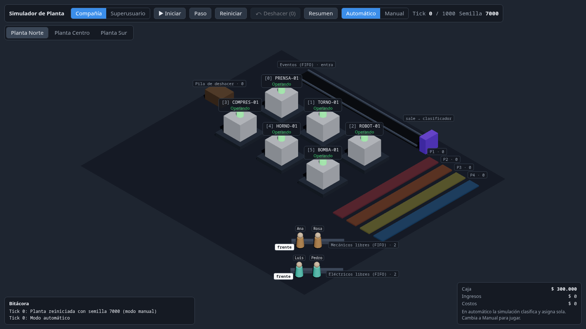
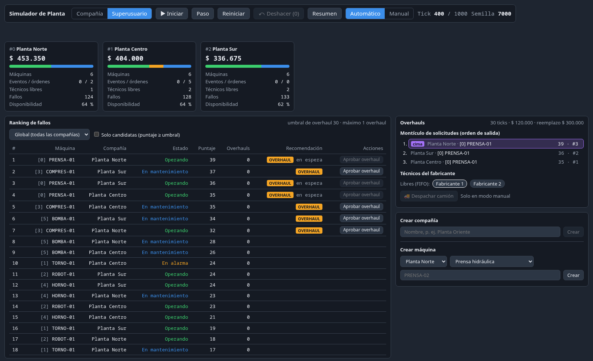

# Simulador de Monitoreo y Mantenimiento de Planta

Proyecto final del curso **Estructuras de Datos** — Universidad Nacional de Colombia.

**Equipo:** Cristian Robayo y Kevin Toro.

---

## Qué hace

Simula varias compañías industriales (tres al arrancar: Planta Norte, Centro y Sur), cada una con
máquinas que reportan lecturas de sensores. El sistema genera fallos, detecta anomalías en las
lecturas, las clasifica por prioridad (P1 a P4, con un esquema inspirado en la norma ISA-18.2) y
genera órdenes de mantenimiento que asigna a técnicos mecánicos y eléctricos.

Encima de eso hay:

- un **superusuario** que ve todas las compañías, con un ranking de máquinas por fallos y su
  recomendación de overhaul o reemplazo;
- un **modo manual**, que convierte la simulación en un juego de gestión: el jugador decide qué
  hacer, cuándo y con qué recurso, y paga por ello, en partidas de 1000 ticks con caja y quiebra;
- un **historial** de fallos y de costo que se consulta por una ventana de ticks.

**Este repositorio es el backend** (Spring Boot): expone la simulación como una API REST. La interfaz
es un frontend web en otro repositorio, un diorama 3D donde **cada estructura de datos es un objeto
que se comporta como su tipo abstracto**: la cola de eventos es una banda transportadora, la cola
P1–P4 un tablero de cuatro carriles y la pila un montón de carpetas.

- **Frontend:** [`ProyectoFinalED-frontend`](https://github.com/Torito9609/ProyectoFinalED-frontend)
  (React + Vite + TypeScript + React Three Fiber)
- **Contrato de la API:** [`docs/API.md`](docs/API.md)





## Estructuras de datos utilizadas

La justificación completa de cada decisión está en
[`docs/DOCUMENTO_EXPLICATIVO.md`](docs/DOCUMENTO_EXPLICATIVO.md): la primera parte cubre la Entrega 1
y la segunda la Entrega 2.

**Entrega 1:** las **cinco** estructuras lineales del enunciado.

| Estructura | Implementación | Para qué se usa |
|---|---|---|
| Arreglo dinámico | `ArrayList` | Inventario de máquinas |
| Cola circular | **Propia** (`ColaCircular<T>`) | Últimas N lecturas de cada máquina |
| Cola FIFO | `ArrayDeque` | Eventos por clasificar y técnicos disponibles |
| Cola con prioridad | Arreglo de 4 `ArrayDeque` | Órdenes de trabajo P1–P4 |
| Pila | `ArrayDeque` | Deshacer acciones del operador |

**Entrega 2:** varias compañías, un ranking de fallos, overhauls y un historial por ventana de ticks.

| Estructura | Implementación | Para qué se usa |
|---|---|---|
| Arreglo dinámico | `ArrayList<Planta>` | Compañías; el id es el índice |
| Conjunto | `TreeSet<String>` | Nombres de compañías y etiquetas de máquinas, sin repetir |
| Árbol de búsqueda balanceado | `TreeSet<Maquina>` (rojo-negro) | Ranking de máquinas por puntaje de fallos, por compañía y global |
| Montículo | `PriorityQueue` | Solicitudes de overhaul: la máquina en peor estado primero |
| Colas FIFO | `ArrayDeque` | Técnicos libres por especialidad y técnicos del fabricante |
| Árbol de segmentos | **Propio** (`ArbolSegmentos`) | Total y pico de fallos y de costo entre dos ticks |

Hay dos estructuras implementadas a mano, porque la librería estándar de Java no las ofrece: la
**cola circular** que sobrescribe el elemento más antiguo al llenarse, y el **árbol de segmentos**.

## Requisitos

- **JDK 21** o superior (el proyecto compila con `release=21`, así que el bytecode funciona en
  Java 21 aunque se construya con un JDK más nuevo).
- **Maven 3.9+**, o simplemente el wrapper incluido (`./mvnw`), que no requiere instalar Maven.

Dependencias: **Spring Boot** (starter web MVC, que trae Tomcat y Jackson) y, para las pruebas, el
starter de pruebas (JUnit 5 y MockMvc). El wrapper las descarga solas.

## Cómo compilar y ejecutar

### Backend y frontend con un solo comando

Con el [frontend](https://github.com/Torito9609/ProyectoFinalED-frontend) clonado en la carpeta hermana
`../ProyectoFinalED-frontend` (además del JDK, necesita Node.js 22 o superior):

```bash
./levantar.sh                                  # backend en :8080 y frontend en http://localhost:5173
FRONTEND_DIR=/ruta/al/frontend ./levantar.sh   # si el frontend está en otra carpeta
```

En Windows, desde PowerShell:

```powershell
powershell -ExecutionPolicy Bypass -File .\levantar.ps1
powershell -ExecutionPolicy Bypass -File .\levantar.ps1 -FrontendDir C:\ruta\al\frontend
```

O con doble clic en `levantar.cmd`, que llama a `levantar.ps1`.

Los dos scripts hacen lo mismo: revisan que los puertos 8080 y 5173 estén libres, instalan las
dependencias del frontend la primera vez, esperan a que la API responda y luego abren el frontend. La
salida del backend queda en `target/backend.log`. **Ctrl+C detiene los dos.**

### Solo el backend

```bash
# Compilar y correr las pruebas
./mvnw test

# Ejecutar el backend (queda escuchando en http://localhost:8080)
./mvnw spring-boot:run

# O construir el jar ejecutable y correrlo
./mvnw package
java -jar target/simulador-planta.jar

# Opcional: otra semilla (la misma semilla repite la misma simulación) u otro puerto
java -jar target/simulador-planta.jar --planta.semilla=42 --server.port=9090
```

La simulación arranca **en pausa**. Para verla avanzar sin el frontend:

```bash
curl -X POST localhost:8080/api/simulacion/iniciar
curl localhost:8080/api/companias/0
```

La semilla, el intervalo del reloj y los orígenes permitidos por CORS se configuran en
`src/main/resources/application.properties`.

Desde IntelliJ IDEA: abrir la carpeta del proyecto, dejar que importe el `pom.xml` y ejecutar la
clase `edu.unal.planta.AplicacionPlanta`.

Para generar la documentación Javadoc:

```bash
./mvnw clean javadoc:javadoc    # queda en target/reports/apidocs/index.html
```

El `clean` es necesario: sin él, el plugin omite regenerar la documentación si la salida anterior
sigue siendo más reciente que las fuentes, y la verificación no comprueba nada.

## Estructura del proyecto

```
levantar.sh, levantar.ps1, levantar.cmd   levantan el backend y el frontend juntos (Linux/macOS, Windows)
src/main/java/edu/unal/planta/
├── AplicacionPlanta.java punto de entrada de Spring Boot
├── api/                 controladores REST (rutas /api/...)
│   └── dto/             records inmutables que viajan como JSON (copias del estado)
├── servicio/             dueño único del modelo y reloj de la simulación
├── estructuras/          estructuras propias y genéricas (ColaCircular, ArbolSegmentos)
└── modelo/               dominio y simulación; Java puro, no conoce la vista ni el framework
    └── comandos/         acciones del operador que se pueden deshacer
```

Desde la Entrega 2 este repositorio es el **backend**: la vista es un frontend web en otro
repositorio. El paquete `servicio/` es el dueño único del modelo y lleva el reloj; `api/` tiene los controladores REST y
sus DTOs. La dependencia va en un solo sentido: la API conoce el
servicio y el servicio conoce el modelo, pero el modelo no conoce a ninguno. Por eso la simulación
completa se puede probar con JUnit sin levantar un servidor.

## Cómo usarlo

Desde el frontend web. El [manual de usuario](docs/MANUAL_USUARIO.md) explica cada pantalla, el
juego en modo manual y una guía para la demostración. Para usar la API sin el frontend, los
endpoints, sus cuerpos y sus errores están en [`docs/API.md`](docs/API.md).

La interfaz Swing de la Entrega 1 se retiró del código. Ella y su manual se conservan en la etiqueta
`entrega-1` (`git switch --detach entrega-1`).

## Flujo de trabajo con Git

Todo el trabajo de las entregas 1 y 2 está integrado en `main`, que es la rama que se entrega y la
que debe compilar siempre. Las ramas de trabajo (`desarrollo` en la Entrega 1 y `entrega-2` en la
Entrega 2) se borraron al cerrar la Entrega 2. Cada entrega queda marcada con una etiqueta
(`entrega-1`).

Para trabajo nuevo (por ejemplo, la etapa G para la entrega final):

1. Se crea una rama desde `main` y los commits van ahí, nunca directo sobre `main`.
2. La rama se integra a `main` solo cuando `./mvnw test` pasa completo.

```bash
git switch -c entrega-final main   # rama de trabajo
# ... commits ...
./mvnw test                        # obligatorio antes de integrar

git switch main
git merge --no-ff entrega-final    # el trabajo queda marcado en la historia
```

Los commits hechos con asistencia de IA conservan la línea `Co-Authored-By` que agrega la
herramienta; los commits sin esa línea fueron escritos por el equipo. Esa es la trazabilidad que
respalda a [`docs/USO_IA.md`](docs/USO_IA.md).

## Documentación

- [`docs/API.md`](docs/API.md) — contrato de la API REST para el frontend
- [`docs/MANUAL_USUARIO.md`](docs/MANUAL_USUARIO.md) — cómo instalar y usar el simulador (versión web)
- [`docs/DOCUMENTO_EXPLICATIVO.md`](docs/DOCUMENTO_EXPLICATIVO.md) — por qué y cómo se usó cada
  estructura
- [`docs/BITACORA_DESARROLLO.md`](docs/BITACORA_DESARROLLO.md) — registro de avance del equipo:
  qué se hizo en cada etapa y qué se decidió
- [`docs/USO_IA.md`](docs/USO_IA.md) — declaración del uso de herramientas de IA
- `CLAUDE.md` — documento de diseño; es la fuente de verdad de las decisiones técnicas

## Video

*(pendiente: enlace al video de máximo 5 minutos)*

## Estado

**Entrega 1** (versión Swing, etiqueta `entrega-1`; la interfaz se retiró del código en la Entrega 2):

| Entregable | Estado |
|---|---|
| Esqueleto del proyecto (Maven, paquetes, JUnit) | Listo |
| `ColaCircular` y `ColaPrioridadOrdenes` con pruebas | Listo |
| Entidades del modelo y configuración | Listo |
| Simulación (`Planta.tick()`) probada sin interfaz | Listo |
| Interfaz Swing (paneles de las 5 estructuras) | Listo |
| Controlador e integración | Listo |
| Manual de usuario | Listo |
| Documento explicativo | Listo |
| Video | Pendiente |

**Entrega 2** (rama `entrega-2`; el avance detallado está en `docs/BITACORA_DESARROLLO.md`):

| Entregable | Estado |
|---|---|
| Migración a Spring Boot, con paridad de la Entrega 1 en la API | Listo |
| Contrato de la API (`docs/API.md`) | Listo |
| Árbol de segmentos | Listo |
| Compañías (crear compañías y máquinas), ranking de fallos, overhaul y reemplazo, modo manual, historial | Listo |
| Endpoints de la Entrega 2 | Listo |
| Documento explicativo de la Entrega 2 | Listo |
| Niveles de dificultad | Pospuesto (ver `CLAUDE.md`, sección 16) |
| Manual de usuario de la Entrega 2 (versión web) | Listo |
| Video de la Entrega 2 | Pendiente |
