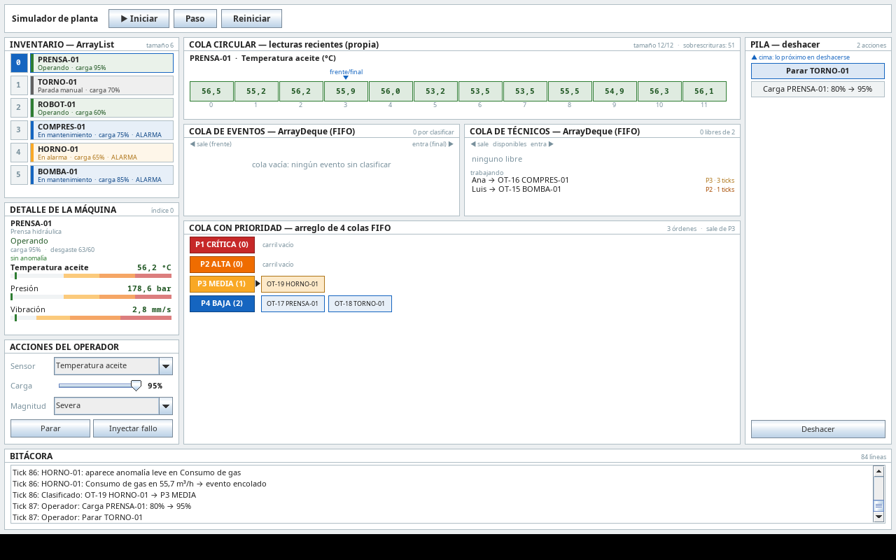

# Simulador de Monitoreo y Mantenimiento de Planta

Proyecto final del curso **Estructuras de Datos** — Universidad Nacional de Colombia.

**Equipo:** Cristian Robayo y Kevin Toro.

---

## Qué hace

Simula una planta industrial con seis máquinas que reportan lecturas de sensores. El sistema genera
fallos, detecta anomalías en las lecturas, las clasifica por prioridad (P1 a P4, con un esquema
inspirado en la norma ISA-18.2) y genera órdenes de mantenimiento que asigna a los técnicos
disponibles.

Lo particular del simulador es que **cada estructura de datos tiene su propio panel en pantalla**,
donde se ve su comportamiento real: el acceso por índice del arreglo, la sobrescritura de la cola
circular, el orden de llegada de las colas FIFO, los cuatro carriles de la cola con prioridad y la
cima de la pila de deshacer.

**Desde la Entrega 2 este repositorio es el backend** (Spring Boot): expone la simulación como una
API REST, y la interfaz es un frontend web en otro repositorio. La captura es de la Entrega 1, la
versión de escritorio en Swing, que se conserva en la etiqueta `entrega-1`.

- **Frontend:** *(pendiente: enlace al repositorio)*
- **Contrato de la API:** [`docs/API.md`](docs/API.md)



## Estructuras de datos utilizadas

El proyecto usa las **cinco** estructuras lineales del enunciado. La justificación completa de cada
decisión está en [`docs/DOCUMENTO_EXPLICATIVO.md`](docs/DOCUMENTO_EXPLICATIVO.md).

| Estructura | Implementación | Para qué se usa |
|---|---|---|
| Arreglo dinámico | `ArrayList` | Inventario de máquinas |
| Cola circular | **Propia** (`ColaCircular<T>`) | Últimas N lecturas de cada máquina |
| Cola FIFO | `ArrayDeque` | Eventos por clasificar y técnicos disponibles |
| Cola con prioridad | Arreglo de 4 `ArrayDeque` | Órdenes de trabajo P1–P4 |
| Pila | `ArrayDeque` | Deshacer acciones del operador |

La cola circular es la única estructura implementada a mano, porque la librería estándar de Java no
ofrece ninguna que **sobrescriba** el elemento más antiguo al llenarse.

## Requisitos

- **JDK 21** o superior (el proyecto compila con `release=21`, así que el bytecode funciona en
  Java 21 aunque se construya con un JDK más nuevo).
- **Maven 3.9+**, o simplemente el wrapper incluido (`./mvnw`), que no requiere instalar Maven.

Dependencias: **Spring Boot** (starter web MVC, que trae Tomcat y Jackson) y, para las pruebas, el
starter de pruebas (JUnit 5 y MockMvc). El wrapper las descarga solas.

## Cómo compilar y ejecutar

```bash
# Compilar y correr las pruebas
./mvnw test

# Ejecutar el backend (queda escuchando en http://localhost:8080)
./mvnw spring-boot:run

# O construir el jar ejecutable y correrlo
./mvnw package
java -jar target/simulador-planta.jar

# Opcional: otra semilla (la misma semilla repite la misma simulación) u otro puerto
java -jar target/simulador-planta.jar --planta.semilla=42 --server.port=9090
```

La simulación arranca **en pausa**. Para verla avanzar sin el frontend:

```bash
curl -X POST localhost:8080/api/simulacion/iniciar
curl localhost:8080/api/planta
```

La semilla, el intervalo del reloj y los orígenes permitidos por CORS se configuran en
`src/main/resources/application.properties`.

Desde IntelliJ IDEA: abrir la carpeta del proyecto, dejar que importe el `pom.xml` y ejecutar la
clase `edu.unal.planta.AplicacionPlanta`.

Para generar la documentación Javadoc:

```bash
./mvnw clean javadoc:javadoc    # queda en target/reports/apidocs/index.html
```

El `clean` es necesario: sin él, el plugin omite regenerar la documentación si la salida anterior
sigue siendo más reciente que las fuentes, y la verificación no comprueba nada.

## Estructura del proyecto

```
src/main/java/edu/unal/planta/
├── AplicacionPlanta.java punto de entrada de Spring Boot
├── api/                 controladores REST (rutas /api/...)
│   └── dto/             records inmutables que viajan como JSON (copias del estado)
├── servicio/             dueño único del modelo y reloj de la simulación
├── estructuras/          estructuras propias y genéricas (ColaCircular)
└── modelo/               dominio y simulación; Java puro, no conoce la vista ni el framework
    └── comandos/         acciones del operador que se pueden deshacer
```

Desde la Entrega 2 este repositorio es el **backend**: la vista es un frontend web en otro
repositorio. El paquete `servicio/` es el dueño único del modelo y lleva el reloj; `api/` tiene los controladores REST y
sus DTOs. La dependencia va en un solo sentido: la API conoce el
servicio y el servicio conoce el modelo, pero el modelo no conoce a ninguno. Por eso la simulación
completa se puede probar con JUnit sin levantar un servidor.

## Cómo usarlo

- **Entrega 2:** desde el frontend web. Los endpoints, sus cuerpos y sus errores están en
  [`docs/API.md`](docs/API.md).
- **Entrega 1:** la interfaz Swing se retiró del código y se conserva en la etiqueta `entrega-1`
  (`git switch --detach entrega-1`). Su manual está en [`docs/MANUAL_USUARIO.md`](docs/MANUAL_USUARIO.md).

## Flujo de trabajo con Git

El repositorio maneja dos ramas (en la Entrega 2 se trabaja en la rama `entrega-2`, con el mismo
criterio que `desarrollo`):

| Rama | Para qué sirve |
|---|---|
| `main` | Solo etapas terminadas y probadas. Es la rama que se entrega y la que debe compilar siempre |
| `desarrollo` | Rama de trabajo diario. Aquí van todos los commits mientras una etapa está en curso |

**Reglas:**

1. No se hace commit directo sobre `main`.
2. Una etapa se integra a `main` solo cuando `./mvnw test` pasa completo.
3. La integración se hace con `--no-ff`, para que quede un commit de merge que marque dónde empieza
   y dónde termina cada etapa en la historia.

```bash
git switch desarrollo            # trabajar siempre aquí
# ... commits de la etapa ...
./mvnw test                      # obligatorio antes de integrar

git switch main
git merge --no-ff desarrollo     # la etapa queda marcada en la historia
git switch desarrollo            # volver a la rama de trabajo
```

Los commits hechos con asistencia de IA conservan la línea `Co-Authored-By` que agrega la
herramienta; los commits sin esa línea fueron escritos por el equipo. Esa es la trazabilidad que
respalda a [`docs/USO_IA.md`](docs/USO_IA.md).

## Documentación

- [`docs/API.md`](docs/API.md) — contrato de la API REST para el frontend
- [`docs/MANUAL_USUARIO.md`](docs/MANUAL_USUARIO.md) — cómo usar el simulador (Entrega 1)
- [`docs/DOCUMENTO_EXPLICATIVO.md`](docs/DOCUMENTO_EXPLICATIVO.md) — por qué y cómo se usó cada
  estructura
- [`docs/BITACORA_DESARROLLO.md`](docs/BITACORA_DESARROLLO.md) — registro de avance del equipo:
  qué se hizo en cada etapa y qué se decidió
- [`docs/USO_IA.md`](docs/USO_IA.md) — declaración del uso de herramientas de IA
- `CLAUDE.md` — documento de diseño; es la fuente de verdad de las decisiones técnicas

## Video

*(pendiente: enlace al video de máximo 5 minutos)*

## Estado

| Entregable | Estado |
|---|---|
| Esqueleto del proyecto (Maven, paquetes, JUnit) | Listo |
| `ColaCircular` y `ColaPrioridadOrdenes` con pruebas | Listo |
| Entidades del modelo y configuración | Listo |
| Simulación (`Planta.tick()`) probada sin interfaz | Listo |
| Interfaz Swing (paneles de las 5 estructuras) | Listo |
| Controlador e integración | Listo |
| Manual de usuario | Listo |
| Documento explicativo | Listo |
| Video | Pendiente |

**Entrega 2** (rama `entrega-2`; el avance detallado está en `docs/BITACORA_DESARROLLO.md`):

| Entregable | Estado |
|---|---|
| Migración a Spring Boot, con paridad de la Entrega 1 en la API | Listo |
| Contrato de la API (`docs/API.md`) | Listo |
| Árbol de segmentos | Pendiente |
| Compañías (crear compañías y máquinas), ranking de fallos, overhaul y reemplazo, modo manual, historial | Pendiente |
| Endpoints de la Entrega 2 | Pendiente |
| Documento explicativo de la Entrega 2 | Pendiente |
