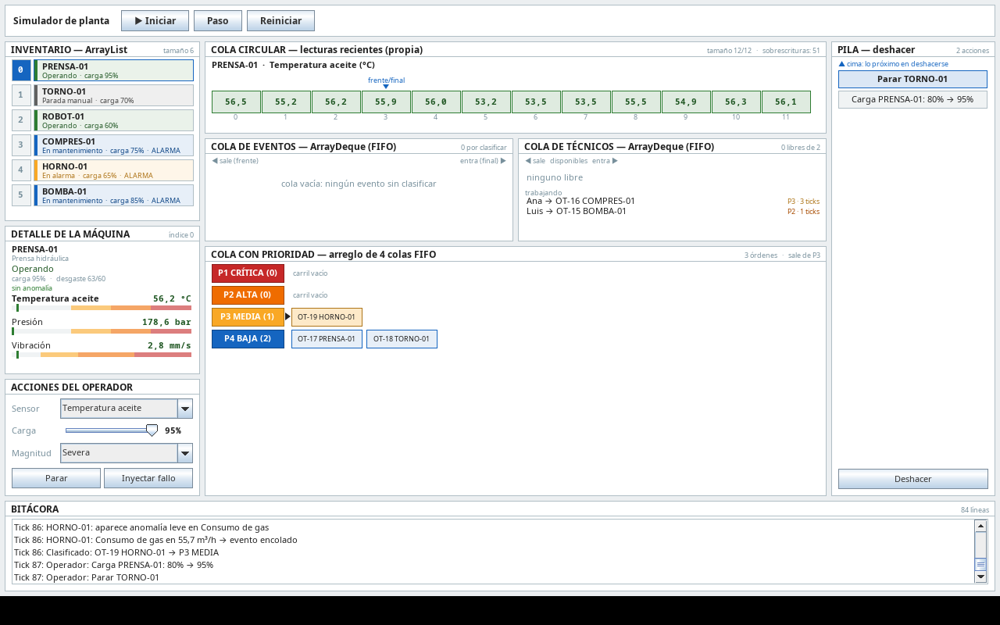

# Simulador de Monitoreo y Mantenimiento de Planta

Proyecto final del curso **Estructuras de Datos** — Universidad Nacional de Colombia.

**Equipo:** Cristian Robayo y Kevin Toro.

---

## Qué hace

Simula una planta industrial con seis máquinas que reportan lecturas de sensores. El sistema genera
fallos, detecta anomalías en las lecturas, las clasifica por prioridad (P1 a P4, con un esquema
inspirado en la norma ISA-18.2) y genera órdenes de mantenimiento que asigna a los técnicos
disponibles.

Lo particular del simulador es que **cada estructura de datos tiene su propio panel en pantalla**,
donde se ve su comportamiento real: el acceso por índice del arreglo, la sobrescritura de la cola
circular, el orden de llegada de las colas FIFO, los cuatro carriles de la cola con prioridad y la
cima de la pila de deshacer.



## Estructuras de datos utilizadas

El proyecto usa las **cinco** estructuras lineales del enunciado. La justificación completa de cada
decisión está en [`docs/DOCUMENTO_EXPLICATIVO.md`](docs/DOCUMENTO_EXPLICATIVO.md).

| Estructura | Implementación | Para qué se usa |
|---|---|---|
| Arreglo dinámico | `ArrayList` | Inventario de máquinas |
| Cola circular | **Propia** (`ColaCircular<T>`) | Últimas N lecturas de cada máquina |
| Cola FIFO | `ArrayDeque` | Eventos por clasificar y técnicos disponibles |
| Cola con prioridad | Arreglo de 4 `ArrayDeque` | Órdenes de trabajo P1–P4 |
| Pila | `ArrayDeque` | Deshacer acciones del operador |

La cola circular es la única estructura implementada a mano, porque la librería estándar de Java no
ofrece ninguna que **sobrescriba** el elemento más antiguo al llenarse.

## Requisitos

- **JDK 21** o superior (el proyecto compila con `release=21`, así que el bytecode funciona en
  Java 21 aunque se construya con un JDK más nuevo).
- **Maven 3.9+**, o simplemente el wrapper incluido (`./mvnw`), que no requiere instalar Maven.

Única dependencia externa: **JUnit 5**, y solo para las pruebas.

## Cómo compilar y ejecutar

```bash
# Compilar y correr las pruebas
./mvnw test

# Construir el jar ejecutable
./mvnw package

# Ejecutar la aplicación
java -jar target/simulador-planta.jar

# Opcional: abrirla con la simulación ya avanzada, para ver las colas con trabajo
java -jar target/simulador-planta.jar 150
```

Desde IntelliJ IDEA: abrir la carpeta del proyecto, dejar que importe el `pom.xml` y ejecutar la
clase `edu.unal.planta.App`.

Para generar la documentación Javadoc:

```bash
./mvnw javadoc:javadoc    # queda en target/reports/apidocs/index.html
```

## Estructura del proyecto

```
src/main/java/edu/unal/planta/
├── App.java              punto de entrada: arma modelo, vista y controlador
├── estructuras/          estructuras propias y genéricas (ColaCircular)
├── modelo/               dominio y simulación; no conoce la interfaz gráfica
│   └── comandos/         acciones del operador que se pueden deshacer
├── vista/                ventana principal y un panel por estructura (Swing)
└── controlador/          reloj de la simulación y acciones del usuario
```

El proyecto sigue el patrón **Modelo-Vista-Controlador**. La dependencia va en un solo sentido: la
vista y el controlador conocen el modelo, pero el modelo no conoce a ninguno de los dos. Por eso la
simulación completa se puede probar con JUnit sin abrir una ventana.

## Flujo de trabajo con Git

El repositorio maneja dos ramas:

| Rama | Para qué sirve |
|---|---|
| `main` | Solo etapas terminadas y probadas. Es la rama que se entrega y la que debe compilar siempre |
| `desarrollo` | Rama de trabajo diario. Aquí van todos los commits mientras una etapa está en curso |

**Reglas:**

1. No se hace commit directo sobre `main`.
2. Una etapa se integra a `main` solo cuando `./mvnw test` pasa completo.
3. La integración se hace con `--no-ff`, para que quede un commit de merge que marque dónde empieza
   y dónde termina cada etapa en la historia.

```bash
git switch desarrollo            # trabajar siempre aquí
# ... commits de la etapa ...
./mvnw test                      # obligatorio antes de integrar

git switch main
git merge --no-ff desarrollo     # la etapa queda marcada en la historia
git switch desarrollo            # volver a la rama de trabajo
```

Los commits hechos con asistencia de IA conservan la línea `Co-Authored-By` que agrega la
herramienta; los commits sin esa línea fueron escritos por el equipo. Esa es la trazabilidad que
respalda a [`docs/USO_IA.md`](docs/USO_IA.md).

## Documentación

- [`docs/MANUAL_USUARIO.md`](docs/MANUAL_USUARIO.md) — cómo usar el simulador *(pendiente)*
- [`docs/DOCUMENTO_EXPLICATIVO.md`](docs/DOCUMENTO_EXPLICATIVO.md) — por qué y cómo se usó cada
  estructura *(pendiente)*
- [`docs/BITACORA_DESARROLLO.md`](docs/BITACORA_DESARROLLO.md) — registro de avance del equipo:
  qué se hizo en cada etapa y qué se decidió
- [`docs/USO_IA.md`](docs/USO_IA.md) — declaración del uso de herramientas de IA
- `CLAUDE.md` — documento de diseño; es la fuente de verdad de las decisiones técnicas

## Video

*(pendiente: enlace al video de máximo 5 minutos)*

## Estado

| Entregable | Estado |
|---|---|
| Esqueleto del proyecto (Maven, paquetes, JUnit) | Listo |
| `ColaCircular` y `ColaPrioridadOrdenes` con pruebas | Listo |
| Entidades del modelo y configuración | Listo |
| Simulación (`Planta.tick()`) probada sin interfaz | Listo |
| Interfaz Swing (paneles de las 5 estructuras) | Listo |
| Controlador e integración | Pendiente |
| Manual de usuario y documento explicativo | Pendiente |
| Video | Pendiente |
