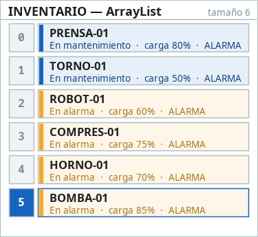
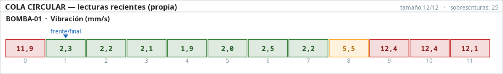
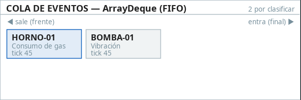
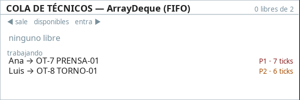
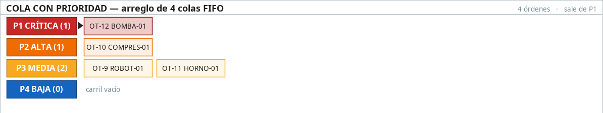
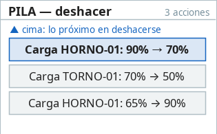

# Por qué y cómo se usó cada estructura de datos

**Simulador de Monitoreo y Mantenimiento de Planta** — Entrega 1.
Curso Estructuras de Datos — Universidad Nacional de Colombia.
Equipo: Cristian Robayo y Kevin Toro.

Este documento justifica cada estructura de datos del proyecto: **qué problema resuelve, por qué es
la adecuada, qué alternativas se descartaron y cuánto cuesta cada operación**. Todo lo que se afirma
aquí corresponde al código real. Cada sección indica la clase y el campo donde está la estructura, y
la sección 8 lista las pruebas que lo respaldan.

---

## Contenido

1. [Introducción](#1-introducción)
2. [Arreglo dinámico — inventario de máquinas](#2-arreglo-dinámico--inventario-de-máquinas)
3. [Cola circular — últimas lecturas de cada máquina](#3-cola-circular--últimas-lecturas-de-cada-máquina)
4. [Cola FIFO — eventos por clasificar y técnicos disponibles](#4-cola-fifo--eventos-por-clasificar-y-técnicos-disponibles)
5. [Cola con prioridad — órdenes de trabajo P1 a P4](#5-cola-con-prioridad--órdenes-de-trabajo-p1-a-p4)
6. [Pila — deshacer acciones del operador](#6-pila--deshacer-acciones-del-operador)
7. [Cómo interactúan las estructuras en un tick](#7-cómo-interactúan-las-estructuras-en-un-tick)
8. [Pruebas](#8-pruebas)
9. [Tabla resumen de complejidades](#9-tabla-resumen-de-complejidades)

---

## 1. Introducción

### El problema

En una planta industrial, cada máquina tiene sensores que miden temperatura, presión, vibración o
corriente. Cuando una lectura se sale de lo normal se dispara una alarma. Esa alarma se clasifica
según su gravedad y termina en una orden de trabajo para un técnico de mantenimiento.

El simulador reproduce ese ciclo con **6 máquinas** y **2 técnicos**:

```
 fallo → lectura anómala → alarma (evento) → clasificación → orden de trabajo → técnico → reparación
```

### Por qué este problema sirve para estructuras lineales

Cada etapa del ciclo es, por naturaleza, una estructura lineal distinta. No buscamos un uso para
cada estructura: el dominio las pide.

- Las alarmas se atienden **en el orden en que llegan** → cola FIFO.
- Las órdenes se atienden **por urgencia**, y entre iguales por orden de llegada → cola con
  prioridad.
- Un registrador de sensores tiene **memoria fija** y conserva solo lo más reciente → cola circular.
- Al operador le interesa revertir **lo último que hizo** → pila.
- Las máquinas son un conjunto que se **recorre completo** y se consulta **por posición** → arreglo
  dinámico.

### Resumen

El enunciado pide al menos tres estructuras lineales. **El proyecto usa las cinco.**

| Estructura | Implementación | Uso | Dónde está |
|---|---|---|---|
| Arreglo dinámico | `ArrayList<Maquina>` | Inventario de máquinas | `Planta.inventario` |
| Cola circular | **`ColaCircular<T>`, propia** | Últimas 12 lecturas de cada máquina | `Maquina.lecturas` |
| Cola FIFO | `ArrayDeque`, declarada como `Queue` | Eventos por clasificar y técnicos libres | `Planta.eventos`, `Planta.tecnicosLibres` |
| Cola con prioridad | Arreglo de 4 `ArrayDeque` | Órdenes de trabajo P1–P4 | `ColaPrioridadOrdenes`, en `Planta.ordenes` |
| Pila | `ArrayDeque`, con `push`/`pop` | Deshacer acciones del operador | `Planta.pilaDeshacer` |

### Un criterio que aplicamos en todas

**Una estructura no es solo dónde se guardan datos: también define qué operaciones están
permitidas.** A eso se le llama *tipo abstracto de datos* (TAD). Una cola solo deja entrar por el
final y salir por el frente. Una pila solo deja tocar la cima.

En varias decisiones preferimos **respetar el TAD antes que agregar una función**. Por eso la vista
recibe las estructuras en modo de solo lectura (sección 7). Y por eso algunas acciones no se pueden
deshacer (sección 6).

---

## 2. Arreglo dinámico — inventario de máquinas

**Implementación:** `ArrayList<Maquina>`, en el campo `Planta.inventario`.

### Cómo se usa

El inventario contiene las 6 máquinas. Sobre él hacemos tres operaciones:

1. **Recorrerlo completo en cada tick.** Cuatro de los ocho pasos del tick pasan por todas las
   máquinas: generar fallos, leer sensores, detectar anomalías y revisar preventivos.
2. **Acceder por índice.** Cada `EventoFallo` y cada `OrdenTrabajo` guardan el **índice** de su
   máquina, y con ese índice la recuperamos: `inventario.get(orden.indiceMaquina())`.
3. **Agregar al final**, al construir la planta.

Las máquinas **nunca se eliminan** del inventario. Cuando una falla o se repara, cambia su estado,
pero sigue en la misma posición.

### Por qué un arreglo dinámico

| Operación | Costo en `ArrayList` | Frecuencia en el proyecto |
|---|---|---|
| `get(i)`, acceso por índice | **O(1)** | Cada vez que se clasifica, asigna o termina una orden |
| Recorrer todo | O(n) | Cuatro veces por tick |
| `add` al final | **O(1) amortizado** | Solo al crear la planta |
| Eliminar del medio | O(n) | **Nunca** |

La estructura es rápida justo en lo que más usamos (acceso por índice y recorrido) y lenta solo en
lo que no usamos (eliminar del medio). Además, el arreglo guarda los elementos contiguos en memoria,
y por eso recorrerlo es eficiente.

### Por qué el índice y no una referencia a la máquina

La orden de trabajo guarda `indiceMaquina` en vez de un objeto `Maquina`. El acceso por índice es
O(1), así que no se pierde nada. A cambio, se gana:

- La orden no apunta a la máquina y la máquina no apunta a la orden: no hay referencia circular.
- La orden puede ser **inmutable** (es un `record`), así que se puede entregar a la vista sin
  riesgo.

Esta decisión depende de que las máquinas **nunca se eliminen**. Si se eliminara una, los índices
de las que vienen después cambiarían.

### Por qué agregar es O(1) *amortizado* y no O(1)

Internamente, `ArrayList` es un arreglo normal con más espacio del que usa. Al agregar un elemento
hay dos casos:

- **Hay espacio libre:** se escribe en la siguiente posición. Cuesta O(1).
- **El arreglo está lleno:** se crea uno **1,5 veces más grande** y se copian todos los elementos.
  Ese agregado cuesta O(n).

Como el arreglo crece en proporción a su tamaño, las copias son cada vez menos frecuentes. Si se
reparte el costo total entre todos los agregados, cada uno cuesta en promedio O(1). Eso significa
*amortizado*: algunas operaciones son caras, pero el promedio a largo plazo es constante.

### Por qué no un arreglo fijo (`Maquina[]`)

Con 6 máquinas fijas, un arreglo normal también funcionaría. Elegimos el dinámico por dos razones:

1. El alcance opcional del proyecto (sección 10 de `CLAUDE.md`) incluye **agregar máquinas desde la
   interfaz**. Con `ArrayList` eso no exige reescribir nada.
2. `ArrayList` se integra con el resto de la librería, por ejemplo para entregar la lista a la vista
   como **no modificable**, con `Collections.unmodifiableList`.

### Cómo se ve en la interfaz

El panel **INVENTARIO — ArrayList** dibuja una fila por posición, con el **índice a la izquierda**,
porque el acceso por índice es lo que caracteriza a la estructura. No se dibuja la capacidad
interna del `ArrayList`: Java no la expone, e inventarla sería mostrar una memoria que no conocemos.



---

## 3. Cola circular — últimas lecturas de cada máquina

**Implementación: propia**, la clase genérica `estructuras/ColaCircular<T>`. Cada máquina tiene la
suya en el campo `Maquina.lecturas`, con capacidad para **12 lecturas**.

### El problema que resuelve

Cada máquina genera una lectura por tick, sin fin. No podemos guardarlas todas, porque la memoria
crecería sin límite. Y tampoco hace falta: para vigilar una máquina interesa lo reciente.

Así funcionan los **registradores de datos industriales**: tienen memoria fija y, cuando se llenan,
la lectura nueva **reemplaza a la más antigua**. Ese comportamiento es exactamente una cola circular
que sobrescribe.

### Por qué la implementamos nosotros

Es la **única estructura propia** del proyecto, y no fue por gusto: **Java no ofrece ninguna cola que
sobrescriba al llenarse.**

| Opción de `java.util` | Qué hace cuando se llena | Por qué no sirve |
|---|---|---|
| `ArrayDeque` | **Crece**: copia todo a un arreglo más grande | Es circular por dentro, pero nunca sobrescribe. La memoria crecería sin límite, que es justo lo que queremos evitar |
| `ArrayBlockingQueue` | **Rechaza** el elemento nuevo, o bloquea el hilo hasta que haya espacio | Hace lo contrario de lo que necesitamos: conserva lo viejo y pierde lo nuevo. Además está diseñada para concurrencia entre hilos, y nuestro programa es de un solo hilo |
| `LinkedList` | Crece | Igual que `ArrayDeque`, y además crea un objeto nodo por elemento |

Hay un segundo motivo. **Ninguna de ellas expone sus índices internos**, y para mostrar en pantalla
cómo funciona una cola circular necesitamos ver las celdas, el frente y el final. Con una clase
propia, decidimos qué consultas ofrecer.

### Cómo funciona

La cola tiene un arreglo de tamaño fijo que **nunca se redimensiona**. En lugar de mover los
elementos, se mueven índices:

```java
private final Object[] celdas;   // arreglo fijo: se crea una vez y nunca crece
private int frente;              // posición del elemento más antiguo
private int tamano;              // cuántos elementos hay
private long sobrescrituras;     // cuántos se han perdido por sobrescritura
```

El **final**, la posición donde se escribirá el próximo elemento, no se guarda. Se calcula:

```java
public int indiceFinal() {
    return (frente + tamano) % celdas.length;
}
```

**El operador módulo es lo que convierte el arreglo en un círculo.** Con capacidad 12, la posición
siguiente a la 11 es `12 % 12 = 0`: el índice vuelve al principio.

Encolar tiene dos casos:

```java
public void encolar(T elemento) {
    Objects.requireNonNull(elemento, "La cola circular no acepta elementos nulos");
    if (estaLlena()) {
        // Con la cola llena, la posición del final coincide con la del frente.
        celdas[frente] = elemento;
        frente = siguiente(frente);
        sobrescrituras++;
    } else {
        celdas[indiceFinal()] = elemento;
        tamano++;
    }
}
```

El caso de la cola llena se resuelve sin ninguna operación especial. Si la cola está llena,
`tamano == capacidad`, entonces `(frente + capacidad) % capacidad == frente`: **el final cae sobre el
frente**. Escribir ahí es sobrescribir el elemento más antiguo. Luego el frente avanza una posición,
porque el más antiguo pasa a ser el siguiente. El tamaño no cambia, porque entró uno y salió otro.

### Ejemplo con capacidad 4

| Acción | Celdas `[0, 1, 2, 3]` | frente | tamaño | final | sobrescrituras |
|---|---|---|---|---|---|
| Cola nueva | `[ -, -, -, - ]` | 0 | 0 | 0 | 0 |
| encolar A, B, C, D | `[ A, B, C, D ]` | 0 | 4 | 0 | 0 |
| encolar E | `[ E, B, C, D ]` | 1 | 4 | 1 | 1 |
| encolar F | `[ E, F, C, D ]` | 2 | 4 | 2 | 2 |
| desencolar → C | `[ E, F, -, D ]` | 3 | 3 | 2 | 2 |

En la última fila sale **C**, que es la más antigua que quedaba, aunque no esté en la celda 0. El
orden lógico es D, E, F, distinto del orden físico de las celdas. Esa diferencia entre el orden
lógico y el físico es la idea central de la estructura.

### Complejidad

| Operación | Costo | Por qué |
|---|---|---|
| `encolar`, con o sin sobrescritura | **O(1)** | Una escritura y aritmética de índices |
| `desencolar` | **O(1)** | Avanza el frente; no se desplaza ningún elemento |
| `verFrente`, `verMasReciente` | **O(1)** | Posición calculada: `frente` y `(frente + tamaño - 1) % capacidad` |
| `contenidoCelda(i)`, `indiceFrente`, `indiceFinal`, `tamano` | **O(1)** | Lectura directa |
| `elementosEnOrden` | O(n) | Copia los n elementos para la vista |
| Construir | O(capacidad) | Única reserva de memoria en toda la vida de la cola |

Hay una diferencia importante con las estructuras de `java.util`. **Aquí encolar es O(1) en todos
los casos, no O(1) amortizado**, porque el arreglo nunca crece y nunca hay que copiarlo. Es la
ventaja de tener memoria fija.

### Decisiones de diseño de la clase

- **No acepta `null`.** Una celda en `null` significa "celda vacía", y así la dibuja el panel. Si
  aceptara nulos, no se podría distinguir un elemento nulo de un hueco.
- **Es genérica (`<T>`)** y está en el paquete `estructuras`, que no conoce nada del dominio. No sabe
  qué es una lectura ni una máquina, así que podría reutilizarse en otro proyecto.
- **El arreglo es `Object[]` y no `T[]`.** Java no permite crear arreglos de un tipo genérico. La
  única conversión sin verificar está aislada en un método privado, `elementoEn`, y es segura porque
  solo `encolar(T)` escribe en el arreglo.
- **`verMasReciente()`** existe porque la detección de anomalías compara contra los umbrales la
  **última** lectura, no la más antigua.
- **Interfaz `ColaCircularSoloLectura<T>`.** `Maquina.lecturas()` devuelve la cola con ese tipo, que
  solo tiene métodos de consulta. La vista recibe la cola real, porque necesita ver sus celdas y
  punteros, pero **no tiene ningún método para modificarla**. Esa regla la verifica el compilador.

### Cómo se ve en la interfaz

El panel **COLA CIRCULAR** es el único que dibuja el **arreglo físico**, con sus 12 celdas
numeradas, los huecos y los punteros `frente` y `final`. Puede hacerlo porque la estructura es
nuestra. Cuando la cola se llena, frente y final coinciden y se ve una sola marca, `frente/final`.
El contador de sobrescrituras muestra cuántas lecturas viejas se perdieron.



---

## 4. Cola FIFO — eventos por clasificar y técnicos disponibles

**Implementación:** `ArrayDeque`, declarada con la interfaz `Queue`:

```java
private final Queue<EventoFallo> eventos = new ArrayDeque<>();
private final Queue<Tecnico> tecnicosLibres = new ArrayDeque<>(tecnicos);
```

Usamos dos colas FIFO, con dos propósitos distintos.

### 4.1 Cola de eventos

Cuando una lectura supera el umbral de advertencia, se crea un `EventoFallo` y se encola:
`eventos.add(...)`. En cada tick se desencola **uno solo**, `eventos.poll()`, y se clasifica.

**Por qué FIFO:** las alarmas detectadas deben pasar a clasificación **en el orden en que
ocurrieron**. Todavía no tienen prioridad: la prioridad la asigna justamente la clasificación. Antes
de clasificarlas no hay ningún criterio para que una pase delante de otra, y el único orden justo es
el de llegada.

**Por qué un solo evento por tick:** si se clasificaran todos de golpe, la cola estaría siempre
vacía y no se vería su comportamiento. Clasificar de a uno representa también una restricción real:
la capacidad de procesamiento del sistema que clasifica es limitada.

### 4.2 Cola de técnicos disponibles

Los técnicos libres esperan en una cola. Al asignar una orden se desencola el primero,
`tecnicosLibres.poll()`. Cuando termina su trabajo, **vuelve al final**, `tecnicosLibres.add(tecnico)`.

**Por qué FIFO:** reparte el trabajo de forma justa. El técnico que lleva más tiempo esperando es el
próximo en recibir trabajo, y quien acaba de terminar se pone de último. Con una lista sin orden, el
mismo técnico podría recibir todas las órdenes mientras el otro espera.

### Por qué `ArrayDeque` y no `LinkedList`

Ambas implementan `Queue` y ofrecen encolar y desencolar en O(1). La diferencia está en cómo
guardan los datos:

| | `ArrayDeque` | `LinkedList` |
|---|---|---|
| Representación | Arreglo circular interno | Un **nodo** por elemento, con referencias al anterior y al siguiente |
| Memoria por elemento | Una referencia en el arreglo | Un objeto nodo completo: encabezado del objeto y tres referencias |
| Basura generada | Casi ninguna | Un objeto nuevo por cada encolado, que luego debe recolectarse |
| Recorrido | Celdas contiguas | Saltos por memoria siguiendo referencias |

La documentación oficial de `ArrayDeque` dice que la clase *"probablemente sea más rápida que
`LinkedList` cuando se usa como cola"*.

### Por qué se declara como `Queue`

La variable es de tipo `Queue`, no `ArrayDeque`, porque `ArrayDeque` también permite sacar por el
final o insertar por el frente. Con el tipo `Queue`, el código solo ve las operaciones de una cola.
Es una forma de **respetar el TAD desde la declaración**.

### Complejidad

| Operación | Método | Costo |
|---|---|---|
| Encolar | `add` | **O(1) amortizado**: el arreglo interno crece cuando se llena, igual que `ArrayList` |
| Desencolar | `poll` | **O(1)** |
| Ver el frente | `peek` | **O(1)** |
| Copia para la vista | `List.copyOf` | O(n) |

### Cómo se ven en la interfaz

Los paneles dibujan **solo la secuencia de elementos**, sin celdas vacías ni capacidad. Es una
decisión deliberada: `ArrayDeque` no expone su arreglo interno, y dibujarlo sería inventar. Las
flechas *sale* y *entra* muestran el comportamiento FIFO.





---

## 5. Cola con prioridad — órdenes de trabajo P1 a P4

**Implementación:** la clase `modelo/ColaPrioridadOrdenes`, un **arreglo de cuatro colas FIFO**, una
por nivel de prioridad:

```java
private final Deque<OrdenTrabajo>[] niveles;   // niveles[0] = P1, ..., niveles[3] = P4
```

### El problema que resuelve

Las órdenes de trabajo deben atenderse:

1. **Por urgencia.** Una P1 (paro de máquina) va antes que una P3 (ir a revisar), aunque haya
   llegado después.
2. **Por orden de llegada entre órdenes de la misma prioridad.** Si hay dos P2, se atiende primero
   la más antigua.

El segundo requisito es tan importante como el primero. En mantenimiento real, atender la segunda
alarma antes que la primera, siendo igual de graves, es un error operativo.

### Cómo funciona

El nivel de la prioridad **es** el índice del arreglo.

**Insertar** va directo a la cola del nivel, sin buscar ni comparar:

```java
public void insertar(OrdenTrabajo orden) {
    niveles[orden.prioridad().nivel()].addLast(orden);
}
```

**Extraer** recorre los niveles desde P1 y saca el frente de la primera cola que tenga algo:

```java
public Optional<OrdenTrabajo> extraer() {
    for (Deque<OrdenTrabajo> cola : niveles) {
        if (!cola.isEmpty()) {
            return Optional.of(cola.removeFirst());
        }
    }
    return Optional.empty();
}
```

Los dos requisitos se cumplen **por construcción**:

- La urgencia se respeta porque se revisa P1 antes que P2, P2 antes que P3, y así sucesivamente.
- El orden de llegada se respeta porque **cada nivel es una cola FIFO**. No hubo que programar
  ningún criterio de desempate: sale solo de la estructura.

### Complejidad

| Operación | Costo | Por qué |
|---|---|---|
| Insertar | **O(1)** (amortizado, por `ArrayDeque`) | El nivel da el índice directamente |
| Extraer | **O(k), con k = 4** | En el peor caso revisa las cuatro colas |
| Ver el siguiente | O(k) | Mismo recorrido, sin sacar |
| Tamaño de un nivel | O(1) | `size()` de esa cola |
| Tamaño total | O(k) | Suma los cuatro tamaños |

**Por qué O(k) es, en la práctica, tiempo constante.** k es el número de niveles de prioridad, que
está fijado en 4 por el enum `Prioridad`. **No depende de cuántas órdenes haya.** Con 10 órdenes o
con 10 000, extraer revisa como máximo 4 colas.

### Alternativas descartadas

**`PriorityQueue` de Java.** Es la opción "obvia" y la descartamos por dos razones:

1. **No garantiza el orden de llegada entre elementos de igual prioridad.** Su documentación oficial
   lo dice explícitamente: si varios elementos empatan en la prioridad más alta, *"los empates se
   rompen arbitrariamente"*. Dos P2 podrían salir en orden invertido. Para evitarlo habría que
   agregarle a cada orden un número de secuencia y un comparador que lo use: complejidad extra para
   recuperar algo que nuestra estructura cumple sola.
2. **Internamente es un *heap*** (montículo binario), una estructura de árbol, no lineal. Esta
   entrega se limita a estructuras lineales y el curso aún no ha visto heaps.

Además, sus costos son O(log n) para insertar y extraer, que dependen de la cantidad de órdenes.
Los nuestros son O(1) y O(4).

**Una sola lista ordenada por prioridad.** Es la versión que vimos en clase, con una lista enlazada.
Extraer es O(1), porque la más urgente siempre está en la cabeza. Pero **insertar es O(n)**, y el
motivo depende de cómo esté hecha la lista:

- **Con una lista enlazada**, hay que **recorrer** los nodos desde la cabeza hasta encontrar la
  posición. Una vez ahí, enlazar el nodo nuevo es O(1): no se mueve ningún elemento.
- **Con un arreglo ordenado**, la posición se puede buscar rápido, pero hay que **desplazar** una
  posición todos los elementos que siguen para abrir el hueco.

En los dos casos el costo crece con la cantidad de órdenes. Nuestra versión inserta en O(1).

Además, en la lista ordenada el orden de llegada entre iguales **depende de programarlo bien**: la
orden nueva debe quedar **después** de todas las de su misma prioridad. Si el recorrido se detiene
en la primera de igual prioridad, la nueva queda delante y el orden se invierte. En nuestra versión
ese error no puede ocurrir, porque cada nivel es una cola y solo se puede entrar por el final.

**Nuestra versión no compite con la lista enlazada.** Cada uno de los cuatro niveles es una cola, y
esa cola podría estar hecha con nodos enlazados en lugar de `ArrayDeque`. La idea central del diseño
es **el arreglo indexado por prioridad**, no cómo está implementado cada carril. Elegimos
`ArrayDeque` para los carriles por las razones de la sección 4.

**Una sola cola, buscando la más prioritaria al extraer.** Insertar sería O(1), pero extraer exigiría
recorrer todas las órdenes y sacar una del medio: O(n). Además, sacar del medio no es una operación
de cola.

| Alternativa | Insertar | Extraer | Orden de llegada entre iguales |
|---|---|---|---|
| **Arreglo de 4 colas (nuestra)** | **O(1)** | **O(4)** | **Garantizado por construcción** |
| `PriorityQueue` | O(log n) | O(log n) | **No garantizado** |
| Lista enlazada ordenada (vista en clase) | O(n), por el recorrido | O(1) | Solo si se inserta después de los iguales |
| Arreglo ordenado | O(n), por el desplazamiento | O(1) | Solo si se inserta después de los iguales |
| Una cola sin orden | O(1) | O(n) | Depende de cómo se busque |

### Limitación de la elección

Esta implementación funciona porque **los niveles son pocos y fijos**. Si la prioridad fuera un
número continuo, por ejemplo un puntaje de 0 a 1000, haría falta una cola por valor posible, y
ahí sí convendría un heap. En nuestro dominio no es el caso: la norma ISA-18.2, en la que nos
basamos, recomienda trabajar con pocos niveles de prioridad (típicamente tres o cuatro).

### Detalles de implementación

- El arreglo es de `ArrayDeque`, por las mismas razones de la sección 4.
- `tamano()` **suma los cuatro niveles** en vez de llevar un contador aparte. Cuesta O(4) y evita un
  dato que podría quedar desincronizado con las colas.
- El enum `Prioridad` tiene un bloque estático que **verifica que `nivel == ordinal()`**. Si alguien
  reordena las constantes del enum y olvida corregir los niveles, el programa falla al arrancar en
  vez de mandar órdenes al carril equivocado.
- La vista la recibe como `ColaPrioridadSoloLectura`, una interfaz sin métodos para insertar ni
  extraer. `ordenesDe(prioridad)` entrega una **copia no modificable** de cada carril.

### Cómo se ve en la interfaz

El panel muestra la estructura tal como es: **cuatro carriles horizontales, cada uno una fila FIFO**.
Una flecha marca el carril del que sale la próxima orden. En la imagen, `OT-12 BOMBA-01` llegó
**después** de todas las demás, pero es P1 y sale primero. Dentro del carril P3, `OT-9` sale antes
que `OT-11` porque llegó antes.



---

## 6. Pila — deshacer acciones del operador

**Implementación:** `ArrayDeque`, con `push` y `pop`:

```java
private final Deque<ComandoOperador> pilaDeshacer = new ArrayDeque<>();
```

### El problema que resuelve

El operador puede cambiar la carga de una máquina o pararla y arrancarla a mano. Si se equivoca,
quiere **revertir lo último que hizo**. Si vuelve a pedir deshacer, quiere revertir lo anterior a
eso. Es el orden inverso al de ejecución: **último en entrar, primero en salir (LIFO)**, que es
justamente una pila.

### Cómo funciona: el patrón Comando

Cada acción deshacible es un objeto que implementa `ComandoOperador`, con tres operaciones:
`ejecutar`, `deshacer` y `sePuedeDeshacer`. Hay dos comandos: `CambiarCargaMaquina` y
`PararOArrancarMaquina`.

Al crearse, cada comando **guarda el estado anterior**. Por ejemplo, `CambiarCargaMaquina` guarda la
carga que había antes. Así sabe cómo revertirse.

```java
// Planta.ejecutar
comando.ejecutar();
pilaDeshacer.push(comando);

// Planta.deshacer
ComandoOperador comando = pilaDeshacer.pop();
if (comando.sePuedeDeshacer()) {
    comando.deshacer();
} else {
    registrar("Descartado, la simulación ya cambió el estado: " + comando.descripcion());
}
```

### Complejidad

| Operación | Costo |
|---|---|
| `push` (apilar) | **O(1) amortizado** |
| `pop` (desapilar) | **O(1)** |
| Copia de las descripciones para la vista | O(n) |

### Por qué `ArrayDeque` y no `Stack`

Java tiene una clase llamada `Stack`, y **la descartamos a propósito**:

1. **Hereda de `Vector`**, que **sincroniza todos sus métodos**. Cada `push` y cada `pop` adquieren
   un candado pensado para varios hilos. Nuestro programa corre en un solo hilo, así que ese costo
   no aporta nada.
2. **Rompe el concepto de pila.** Al heredar de `Vector`, `Stack` permite `get(i)`, `add(i, x)` y
   `remove(i)`: leer, insertar y borrar en cualquier posición. Una pila solo debería permitir tocar
   la cima.
3. **La documentación oficial de Java recomienda no usarla.** La propia página de `Stack` dice que
   la interfaz `Deque` ofrece *"un conjunto más completo y consistente de operaciones de pila"* y
   que debe preferirse.

### Y la pila con nodos que vimos en clase

En clase implementamos la pila como una lista enlazada: cada elemento es un nodo que apunta al de
abajo, y la pila guarda una referencia a la cima. Esa versión es correcta y tiene el mismo costo:

| | Lista enlazada (clase) | `ArrayDeque` (proyecto) |
|---|---|---|
| `push` | O(1): se crea un nodo y pasa a ser la cima | O(1) amortizado: se escribe en el arreglo, que crece si se llena |
| `pop` | O(1): la cima pasa a ser el nodo de abajo | O(1) |
| Memoria por elemento | Un objeto nodo completo, con el dato y la referencia al siguiente | Una referencia en el arreglo |
| Ventaja principal | Nunca hay que copiar elementos | Menos memoria y menos objetos que recolectar |

Las dos implementan **el mismo tipo abstracto de datos**: solo se toca la cima, y lo último en
entrar es lo primero en salir. Elegimos `ArrayDeque` porque ya viene probada en la librería
estándar, ocupa menos memoria y la documentación de Java la recomienda para pilas. Implementar
nuestra propia pila con nodos no habría agregado ningún comportamiento nuevo. La única estructura que
implementamos fue la cola circular, porque ninguna clase de Java ofrece lo que necesitábamos.

El "costo" de la versión enlazada, crear un objeto por elemento, no se nota en una pila de unas
pocas acciones del operador. La decisión no se tomó por rendimiento, sino por **usar la herramienta
estándar cuando ya existe**, y dedicar el esfuerzo de implementación a la que no existe.

### Qué se puede deshacer y qué no

**Se puede deshacer:** cambiar la carga, y parar o arrancar una máquina.

**No se puede deshacer:** clasificar un evento, asignar una orden a un técnico ni inyectar un fallo.

Esta es la decisión de diseño más importante de la sección, y **la tomamos por respetar el TAD**.
Veamos qué exigiría deshacer cada una:

| Acción | Para deshacerla habría que... | Qué regla se viola |
|---|---|---|
| Clasificar un evento | Sacar la orden de la cola con prioridad, aunque no sea la siguiente, y **volver a poner el evento al frente** de la cola de eventos | En una cola solo se entra por el **final**, y solo sale el elemento del **frente** |
| Asignar una orden | Quitarle la orden al técnico, **reinsertarla al frente de su carril** y devolver al técnico **al frente** de la cola de técnicos | Lo mismo, en dos colas a la vez |
| Inyectar un fallo | Si el fallo ya generó un evento o una orden, **sacarlos del medio** de su cola | No se puede sacar un elemento del medio de una cola |

Técnicamente, `ArrayDeque` tiene `addFirst`, así que podríamos haberlo hecho. Pero hacerlo
convertiría nuestras colas en algo que ya no son colas, y el resto del sistema perdería las
garantías de orden que justifican usarlas. **Preferimos no ofrecer la función antes que romper el
tipo abstracto de datos.**

### El caso borde: deshacer algo que la simulación ya cambió

Ejemplo: el operador arranca una máquina, una alarma crítica (P1) la detiene, y después el operador
pulsa *Deshacer*. Si el comando se aplicara, la máquina pasaría a "parada manual" e ignoraría la
alarma.

Por eso cada comando verifica, con `sePuedeDeshacer()`, que **el estado actual siga siendo el que él
dejó**. Si no, el comando **se saca de la pila pero no se aplica**, y la bitácora lo registra. La
pila sigue siendo una pila: se hace `pop` de la cima. Lo único que cambia es si la acción se revierte.

### Cómo se ve en la interfaz

Pila vertical, con **la cima arriba**, resaltada, y el botón *Deshacer* debajo. La vista recibe solo
**textos**, no los objetos comando. Si recibiera los comandos, podría ejecutarlos o revertirlos por
su cuenta, y eso saltaría al controlador.



---

## 7. Cómo interactúan las estructuras en un tick

El método `Planta.tick()` ejecuta ocho pasos en un orden fijo. La tabla muestra qué estructura toca
cada paso:

| # | Paso | Estructuras | Operación |
|---|---|---|---|
| 1 | Generar fallos | Arreglo dinámico | Recorrer: a cada máquina operando y sin anomalía se le sortea un fallo |
| 2 | Leer sensores | Arreglo dinámico → **cola circular** | Recorrer; cada máquina en marcha **encola** su lectura (sobrescribiendo si está llena) |
| 3 | Detectar | Cola circular → **cola de eventos** | **Ver la más reciente**; si supera el umbral, **encolar** un `EventoFallo` |
| 4 | Clasificar | Cola de eventos → **cola con prioridad** | **Desencolar un evento**, clasificarlo e **insertar** la orden en su nivel |
| 5 | Avanzar trabajos | **Cola de técnicos** | Al terminar, la máquina vuelve a operar y el técnico se **encola al final** |
| 6 | Asignar | **Cola con prioridad** + **cola de técnicos** | Mientras haya ambos: **extraer** la orden más urgente y **desencolar** un técnico |
| 7 | Preventivo | Arreglo dinámico → **cola con prioridad** | Recorrer; si una máquina cumplió su intervalo, **insertar** una orden P4 |
| 8 | Notificar | — | Avisar a los observadores (la vista) para que redibujen |

La **pila** no participa en el tick: solo la tocan las acciones del operador.

### Un ejemplo completo

Al inyectar un fallo severo en la vibración de PRENSA-01, un solo tick recorre cuatro estructuras.
Esta es la bitácora real con la semilla 7:

```
Tick 14: PRENSA-01: Vibración en 12,5 mm/s → evento encolado      ← cola circular → cola de eventos
Tick 14: Clasificado: OT-3 PRENSA-01 → P1 CRÍTICA                 ← cola de eventos → cola con prioridad
Tick 14: PRENSA-01: paro inmediato por alarma crítica
Tick 14: Ana atiende OT-3 PRENSA-01 (P1, 10 ticks)                ← cola con prioridad + cola de técnicos
```

### Por qué el orden de los pasos importa

- La anomalía aparece (paso 1) **antes** de que se lea el sensor (paso 2), para que la lectura la
  refleje en el mismo tick.
- Los trabajos avanzan (paso 5) **antes** de asignar (paso 6), para que un técnico que acaba de
  terminar pueda recibir otra orden en el mismo tick.

### Por qué hay dos colas: `EventoFallo` y `OrdenTrabajo`

Podríamos haber convertido cada alarma en orden de inmediato, con una sola cola. Las separamos
porque **así está dividido el trabajo en la industria**:

| Etapa | En la industria | En el simulador |
|---|---|---|
| Detectar | El PLC compara la lectura con un límite | Paso 3, genera un `EventoFallo` **sin prioridad** |
| Clasificar | El SCADA decide la gravedad de la alarma | El `Clasificador`, paso 4 |
| Gestionar | El sistema de mantenimiento crea y asigna la orden | `OrdenTrabajo` en la cola con prioridad, paso 6 |

Por eso son dos estructuras distintas. **Antes de clasificar no hay prioridad, así que el único orden
posible es el de llegada (FIFO). Después de clasificar sí la hay, así que se usa la cola con
prioridad.** Cada cola corresponde a lo que se sabe del dato en ese momento.

Además, el `Clasificador` **no conoce** la magnitud con que se generó el fallo. Solo compara el valor
leído contra los umbrales del sensor, así que funcionaría igual con datos de una planta real.

### Por qué el modelo nunca entrega las estructuras originales

La vista dibuja las estructuras, pero **no puede modificarlas**. Cada una se entrega de una forma
que lo impide:

| Estructura | Lo que recibe la vista |
|---|---|
| Inventario | `Collections.unmodifiableList(inventario)` |
| Cola de eventos y cola de técnicos | `List.copyOf(...)`: una copia inmutable |
| Cola circular | La interfaz `ColaCircularSoloLectura`, sin métodos de modificación |
| Cola con prioridad | La interfaz `ColaPrioridadSoloLectura`; cada carril como copia inmutable |
| Pila | Una lista no modificable de **textos**, no de comandos |

Así, la única forma de cambiar el estado es a través del controlador, como exige la arquitectura
MVC del proyecto.

### Por qué 6 máquinas y 2 técnicos

Una máquina con un fallo activo no desarrolla otro, así que el número de máquinas pone un **techo**
a los fallos simultáneos. Las órdenes sí pueden superar ese número, porque una máquina puede tener
a la vez una correctiva y un preventivo P4. En una primera versión con 3 máquinas, medimos 1000 ticks y **la cola con
prioridad nunca pasó de una orden**: los paneles se habrían visto vacíos. Con 6 máquinas,
reparaciones de 4 a 10 ticks y 2 técnicos, la cola tiene órdenes en cerca del **38 % de los ticks**,
con un máximo de 4. La planta se ve ocupada pero no saturada. El detalle de esa calibración está en
[`BITACORA_DESARROLLO.md`](BITACORA_DESARROLLO.md).

---

## 8. Pruebas

Hay **60 pruebas JUnit 5**, todas en verde (`./mvnw test`). Están agrupadas con `@Nested` y escritas
con `@DisplayName` en español, para que el informe se lea como una lista de propiedades.

### `ColaCircularTest` — los seis casos obligatorios

| Caso exigido | Qué se verifica |
|---|---|
| **Cola vacía** | No tiene elementos; todas sus celdas están vacías; desencolar y ver el frente lanzan excepción; frente y final apuntan a la misma celda |
| **Llenado exacto** | Sin sobrescrituras; elementos en celdas consecutivas desde la 0; con la cola llena el final vuelve a coincidir con el frente |
| **Sobrescritura** | Al encolar en una cola llena se descarta el más antiguo, y el nuevo ocupa **la celda física** del que salió |
| **Varias vueltas completas** | Tras diez elementos en una cola de tres solo quedan los tres últimos; el frente vuelve a pasar por la celda 0; la capacidad nunca cambia |
| **Desencolar después de dar la vuelta** | Los elementos salen en orden de antigüedad aunque el arreglo esté rotado; se libera la celda; se puede volver a encolar |
| **Capacidad 1** | Cada elemento nuevo reemplaza al anterior; frente y final siempre en la única celda |

Además: el rechazo de capacidad inválida y de nulos, y que las listas que recibe la vista sean
copias no modificables.

### `ColaPrioridadOrdenesTest` — los cuatro casos obligatorios

| Caso exigido | Qué se verifica |
|---|---|
| **Orden por prioridad** | Sale primero la de mayor prioridad, sin importar el orden de inserción |
| **FIFO dentro del mismo nivel** | Dentro de un nivel se respeta el orden de llegada, en los cuatro niveles a la vez |
| **Una P1 insertada de última sale primero** | Exactamente eso |
| **Extraer con la estructura vacía** | Devuelve un `Optional` vacío, sin lanzar excepción |

Además: el contrato del enum `Prioridad` (que el nivel coincida con la posición, porque es el índice
del arreglo) y que los carriles entregados a la vista no se puedan modificar.

### `PlantaTest` — la simulación sin interfaz gráfica

Seis pruebas de cadenas completas del tick, sin abrir ninguna ventana:

- La misma semilla produce exactamente la misma simulación.
- Una anomalía severa termina en una orden P1 asignada a un técnico.
- Se clasifica un solo evento por tick.
- Cuando el técnico termina, la máquina vuelve a operar sin anomalía.
- El preventivo genera una sola orden P4 por máquina, no una por tick.
- Deshacer se descarta si la simulación ya cambió el estado.

Que el modelo se pueda probar sin interfaz demuestra que la separación MVC es real.

### Otras pruebas

- `ConfiguracionPlantaTest`: ningún sensor da alarmas falsas por ruido, y cada magnitud de fallo deja
  la lectura en su zona de umbrales.
- `ControladorPlantaTest`: un paso avanza exactamente un tick, reiniciar repite la simulación, parar
  una máquina se puede deshacer.
- `PanelesVistaTest`: todos los paneles se dibujan sin fallar.

---

## 9. Tabla resumen de complejidades

n = cantidad de elementos de la estructura. k = 4 niveles de prioridad, constante.

| Estructura | Insertar | Extraer | Consultar | Recorrer |
|---|---|---|---|---|
| `ArrayList` (inventario) | `add` al final: **O(1) amortizado** | No se usa; costaría O(n) | `get(i)`: **O(1)** | O(n) |
| `ColaCircular` (lecturas) | `encolar`: **O(1)**, incluso al sobrescribir | `desencolar`: **O(1)** | Frente, más reciente o celda i: **O(1)** | O(n) |
| Cola FIFO (`ArrayDeque`) | `add`: **O(1) amortizado** | `poll`: **O(1)** | `peek`: **O(1)** | O(n) |
| Cola con prioridad | `insertar`: **O(1) amortizado** | `extraer`: **O(k) = O(4)** | Siguiente: O(k); tamaño de un nivel: O(1) | O(n) |
| Pila (`ArrayDeque`) | `push`: **O(1) amortizado** | `pop`: **O(1)** | `peek`: **O(1)** | O(n) |

**Por qué "amortizado" en casi todas.** `ArrayList` y `ArrayDeque` guardan sus elementos en un
arreglo que **crece** cuando se llena, copiando todo. Esa copia ocasional es O(n), pero repartida
entre todas las inserciones da O(1) en promedio.

**La excepción es la `ColaCircular`.** Su arreglo **nunca crece**, así que encolar es O(1) siempre,
sin promedios. Es la consecuencia directa de tener memoria fija.

