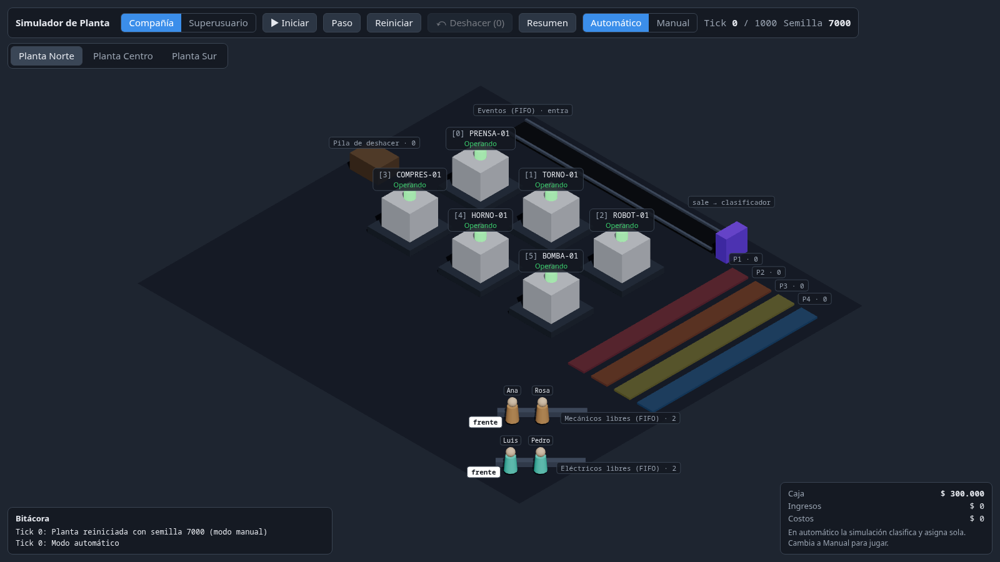
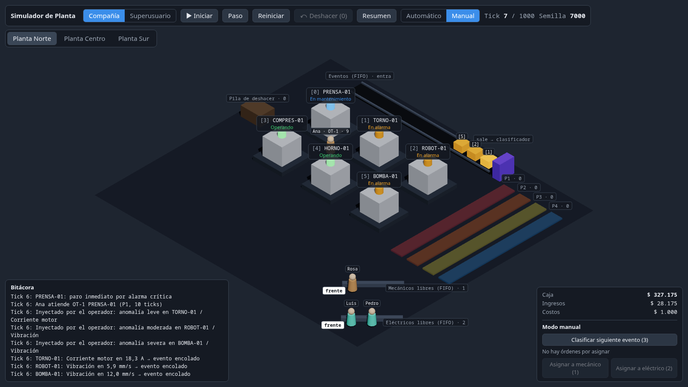
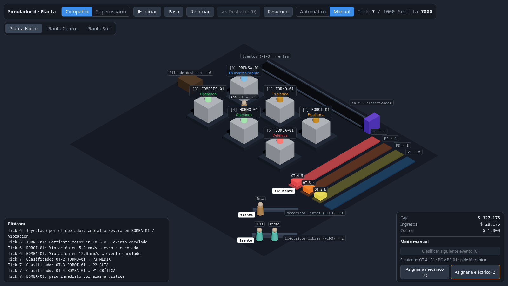
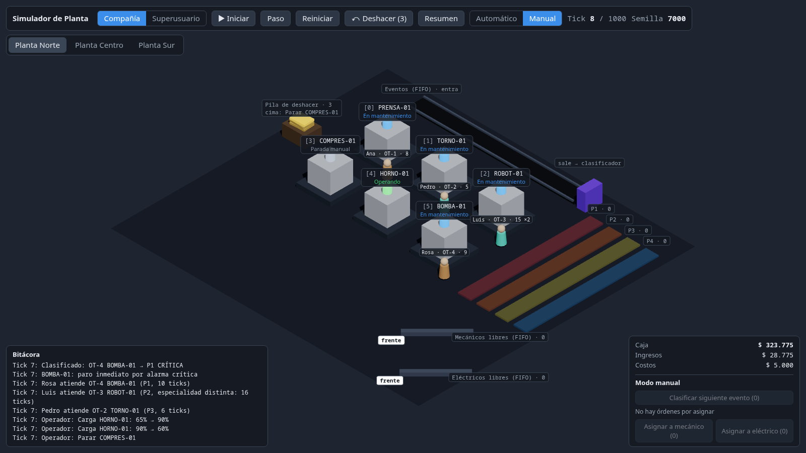
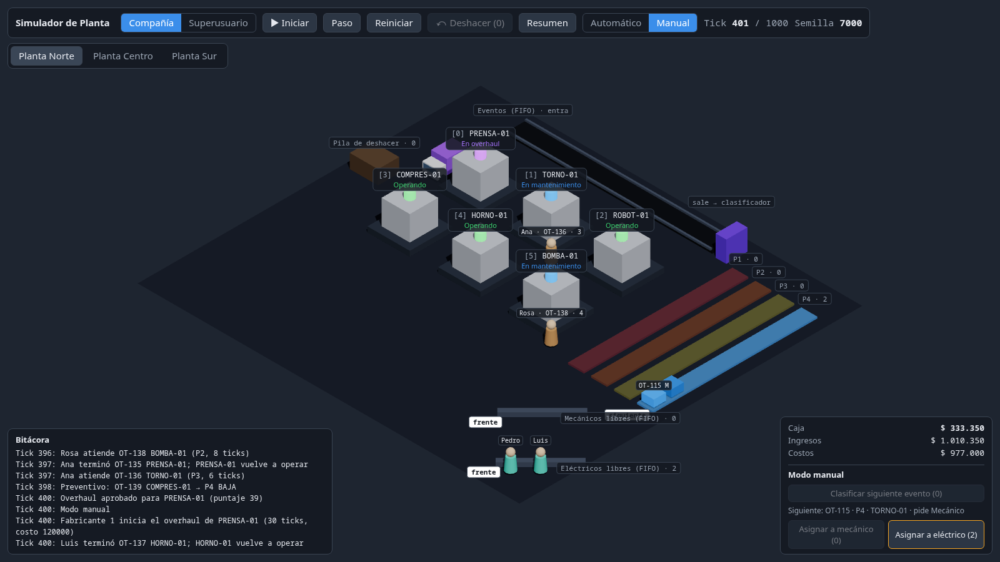
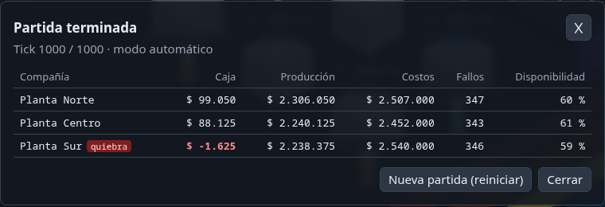
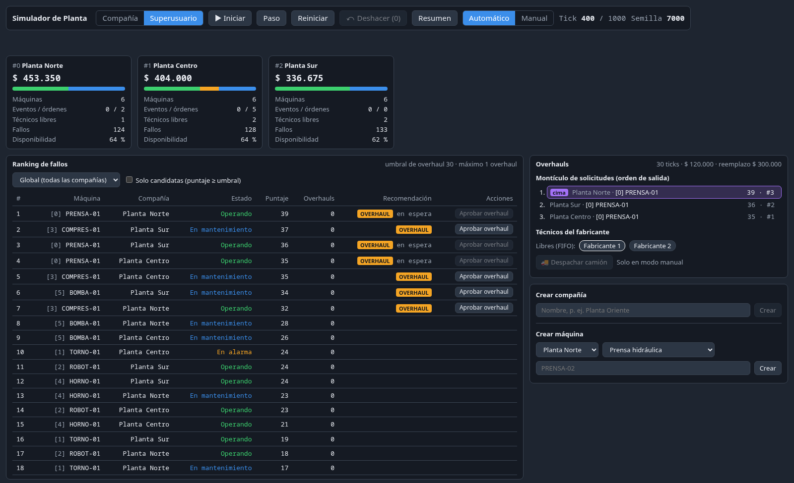
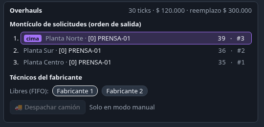
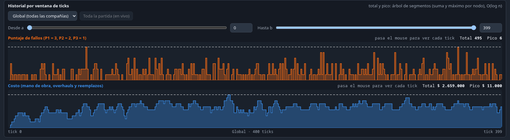

# Manual de usuario

**Simulador de Monitoreo y Mantenimiento de Planta** — versión web (Entrega 2)
Proyecto del curso Estructuras de Datos — Universidad Nacional de Colombia.
Equipo: Cristian Robayo y Kevin Toro.

Este manual explica cómo instalar, abrir y usar el simulador. No hace falta saber programar para
seguirlo. La explicación técnica de por qué se usó cada estructura de datos está en el
[documento explicativo](DOCUMENTO_EXPLICATIVO.md).

> El manual de la Entrega 1 (la ventana de escritorio en Swing) se conserva en la etiqueta
> `entrega-1` del repositorio.

---

## Contenido

1. [Requisitos e instalación](#1-requisitos-e-instalación)
2. [La pantalla principal](#2-la-pantalla-principal)
3. [Controles de la simulación](#3-controles-de-la-simulación)
4. [La planta de una compañía: el diorama](#4-la-planta-de-una-compañía-el-diorama)
5. [Panel de la máquina y acciones del operador](#5-panel-de-la-máquina-y-acciones-del-operador)
6. [Modo manual: el juego de gestión](#6-modo-manual-el-juego-de-gestión)
7. [Vista del superusuario](#7-vista-del-superusuario)
8. [Guía para la demostración](#8-guía-para-la-demostración)
9. [Preguntas frecuentes](#9-preguntas-frecuentes)
10. [Glosario](#10-glosario)

---

## 1. Requisitos e instalación

El simulador tiene dos partes, cada una en su propio repositorio:

- el **backend** ([ProyectoFinalED](https://github.com/Torito9609/ProyectoFinalED)), que ejecuta la
  simulación y guarda todas las estructuras de datos;
- el **frontend** ([ProyectoFinalED-frontend](https://github.com/Torito9609/ProyectoFinalED-frontend)),
  la página web que la muestra.

### Qué necesita

- **Java 21** o una versión más reciente. Compruébelo con `java -version`.
- **Node.js 22** o una versión más reciente. Compruébelo con `node --version`.
- **Git**, para descargar los repositorios.
- Un navegador moderno (Chrome, Firefox o Edge).

### Descargar los dos repositorios

Clónelos **uno al lado del otro**, en la misma carpeta:

```bash
git clone https://github.com/Torito9609/ProyectoFinalED.git
git clone https://github.com/Torito9609/ProyectoFinalED-frontend.git
```

### Abrir el simulador

Desde la carpeta del backend, un solo comando levanta las dos partes:

```bash
cd ProyectoFinalED
./levantar.sh
```

La primera vez tarda un poco más, porque descarga las dependencias. Cuando la terminal diga
`Local: http://localhost:5173/`, abra esa dirección en el navegador.

**Para cerrar el simulador, pulse Ctrl+C en esa terminal:** se detienen las dos partes.

En Windows, abra PowerShell en la carpeta del backend y use la versión para Windows del script:

```powershell
cd ProyectoFinalED
powershell -ExecutionPolicy Bypass -File .\levantar.ps1
```

`-ExecutionPolicy Bypass` permite ejecutar el script sin cambiar la configuración de seguridad del equipo.

Si ninguno de los dos scripts funciona, levante las dos partes a mano, en dos terminales:

```bash
# Terminal 1, en la carpeta del backend
./mvnw spring-boot:run          # en Windows: mvnw.cmd spring-boot:run

# Terminal 2, en la carpeta del frontend
npm install                     # solo la primera vez
npm run dev
```

**Opcional, cambiar la semilla.** La semilla es el número que decide cómo ocurren los fallos al azar
(ver [sección 3](#la-semilla)). Por omisión es **7**. Para usar otra, cambie la línea `planta.semilla=7`
del archivo `src/main/resources/application.properties` del backend antes de levantarlo.

---

## 2. La pantalla principal

Al abrirse, el simulador muestra la planta de la primera compañía, **Planta Norte**: seis máquinas
funcionando con normalidad y cuatro técnicos esperando trabajo. El reloj está detenido: nada cambia hasta
que usted lo pone en marcha.



| Zona | Dónde está | Para qué sirve |
|---|---|---|
| Barra superior | Arriba | Arrancar, pausar, avanzar y reiniciar la simulación; deshacer; cambiar de modo; ver el tick y la semilla |
| Pestañas de compañías | Debajo de la barra | Elegir qué compañía se ve en el diorama |
| Diorama | En el centro | La planta en 3D: cada estructura de datos es un objeto que se ve funcionar |
| Bitácora | Abajo a la izquierda | Las últimas líneas de lo que ha pasado |
| Panel del juego | Abajo a la derecha | La caja de la compañía y, en modo manual, los botones del juego |
| Panel de la máquina | A la derecha, al hacer clic en una máquina | Los datos de la máquina y las acciones del operador |

El botón **Compañía / Superusuario** de la barra cambia entre esta vista y la del superusuario, que ve
todas las compañías a la vez ([sección 7](#7-vista-del-superusuario)).

### Cómo funciona la planta, en pocas palabras

Hay **tres compañías** (Planta Norte, Centro y Sur), cada una con seis máquinas y cuatro técnicos: dos
**mecánicos** (Ana y Rosa) y dos **eléctricos** (Luis y Pedro). En cada **tick** de reloj, en cada
compañía:

1. Alguna máquina puede **desarrollar un fallo**. Cuanta más carga, más desgaste y más fallos previos
   tenga, más probable es.
2. Las máquinas en marcha **leen sus sensores**.
3. Si una lectura se sale de lo normal, se genera una **alarma** (un evento) que entra a la banda de
   eventos.
4. Se **clasifica un evento** según su gravedad (P1 a P4) y se convierte en una **orden de trabajo**.
5. Cada técnico ocupado avanza en su reparación.
6. Los técnicos libres **toman la orden más urgente**, si es de su especialidad.
7. Las máquinas que llevan mucho tiempo sin revisión reciben una orden de **mantenimiento preventivo**
   (P4).
8. Se **cobra y se paga**: las máquinas que producen generan ingresos y los técnicos que trabajan
   cuestan mano de obra.

Una **partida** dura **1000 ticks**. Al terminar se muestra su resumen.

---

## 3. Controles de la simulación

| Control | Qué hace |
|---|---|
| **▶ Iniciar** | Pone en marcha el reloj: avanza un tick cada 0,8 segundos. Mientras corre, el botón cambia a **⏸ Pausar**. |
| **⏸ Pausar** | Detiene el reloj. Todo queda congelado para mirar con calma. |
| **Paso** | Avanza **un solo tick** y se detiene. Es la mejor forma de seguir lo que pasa. |
| **Reiniciar** | Empieza una partida nueva: tick 0, sin alarmas ni órdenes, con las cajas en el presupuesto inicial. Conserva el modo y las compañías y máquinas creadas. |
| **↶ Deshacer (n)** | Revierte la acción más reciente de la compañía que se está viendo. El número es el tamaño de la pila ([sección 5](#deshacer)). |
| **Resumen** | Muestra el resultado de la partida hasta ahora, compañía por compañía. |
| **Automático / Manual** | Cambia el modo de la simulación, sin pausarla ([sección 6](#6-modo-manual-el-juego-de-gestión)). |
| **Tick n / 1000** | El tick actual de la partida. Todas las compañías tienen siempre el mismo tick. |
| **Semilla** | La semilla de la compañía que se está viendo. |

### La semilla

Los fallos aparecen al azar, pero ese azar depende de la semilla. **La misma semilla produce siempre la
misma simulación**: los mismos fallos, en las mismas máquinas, en los mismos ticks. Por eso, si pulsa
**Reiniciar**, todo vuelve a ocurrir exactamente igual.

La barra muestra la semilla **de la compañía** que se está viendo. Cada una se calcula a partir de la
semilla maestra (7 por omisión): Planta Norte usa 7000, Planta Centro 7001 y Planta Sur 7002.

> Sus acciones (inyectar un fallo, cambiar la carga, asignar una orden) sí modifican lo que ocurre
> después. Para repetir una demostración, repita también sus acciones en el mismo tick.

---

## 4. La planta de una compañía: el diorama

Cada estructura de datos de la compañía es un objeto del diorama que se comporta como su estructura:
una fila se mueve como una fila y una pila crece hacia arriba.

### Las máquinas (arreglo dinámico)

Las seis máquinas están en el piso **en el orden de su posición en el inventario** (0 a 5). Cada una
lleva encima una etiqueta con su posición, su nombre y su estado, por ejemplo `[0] PRENSA-01`. La
**baliza** de arriba tiene el color de su estado:

| Color | Estado | Qué significa |
|---|---|---|
| Verde | **Operando** | Funciona con normalidad |
| Ámbar, parpadeando | **En alarma** | Tiene una alarma pendiente y produce a media capacidad |
| Rojo | **Detenida** | Se detuvo sola por una alarma crítica (P1) |
| Azul | **En mantenimiento** | Un técnico la está reparando |
| Gris | **Parada manual** | Usted la detuvo con el botón **Parar** |
| Morado | **En overhaul** | Un técnico del fabricante le hace un servicio completo |

**Haga clic en una máquina** para seleccionarla: se abre su panel ([sección 5](#5-panel-de-la-máquina-y-acciones-del-operador))
y aparece en el piso, alrededor de ella, el anillo de su cola circular. Un clic en el vacío quita la
selección.

### La cola circular de lecturas

Alrededor de la máquina seleccionada aparece un **anillo de 12 baldosas**: las últimas 12 lecturas de
un sensor. Cada baldosa se colorea según la zona en que cayó la lectura (ver la tabla de la
[sección 5](#los-sensores)). El mismo anillo, con los números, está en el panel de la máquina:

- **F (frente)** señala la lectura más antigua que se conserva.
- **L (final)** señala la baldosa donde se escribirá la próxima lectura.

Cuando las 12 baldosas están llenas, **la lectura nueva reemplaza a la más antigua**: frente y final
coinciden, y el contador de **sobrescrituras** sube en cada tick. Se ve el final dar la vuelta al anillo.

### La banda de eventos (cola)

Detrás de las máquinas hay una **banda transportadora** que termina en el **clasificador** (el cubo
morado). Cada caja de la banda es una alarma que todavía no se ha clasificado, con la posición de su
máquina, por ejemplo `[5]`.

- Las alarmas nuevas **entran** por el extremo izquierdo de la banda.
- La caja más cercana al clasificador es la **próxima en salir**.



En la imagen, tres máquinas fallaron en el mismo tick: TORNO-01 (`[1]`) entró primero y será la primera
en clasificarse.

### El tablero P1–P4 (cola con prioridad)

A la derecha hay un tablero de **cuatro carriles**, uno por prioridad. Cada caja es una **orden de
trabajo** esperando técnico:

| Carril | Prioridad | Qué implica |
|---|---|---|
| Rojo | **P1 CRÍTICA** | Paro inmediato de la máquina |
| Naranja | **P2 ALTA** | Atender en el turno |
| Amarillo | **P3 MEDIA** | Ir a revisar |
| Azul | **P4 BAJA** | Mantenimiento preventivo programado |

Junto a cada carril se ve cuántas órdenes tiene (por ejemplo `P1 · 1`). La primera orden de cada carril
lleva su número y la especialidad que pide: `OT-4 M` es la orden 4 y pide un **m**ecánico; `OT-2 E`
pide un **e**léctrico. La marca **siguiente** señala el carril del que sale la próxima orden. Las reglas
son:

1. Siempre sale primero el carril más urgente que tenga órdenes.
2. Dentro de un mismo carril, sale primero la orden que llegó primero.



En la imagen, la orden de BOMBA-01 (`OT-4`) fue la última en clasificarse, pero es crítica: será la
primera en atenderse.

### Las bancas de los técnicos (dos colas)

Abajo hay **dos bancas**: una de mecánicos y otra de eléctricos. Los técnicos libres esperan sentados
en fila; el que está junto a la marca **frente** es el próximo en recibir una orden de su especialidad.

Cuando un técnico recibe una orden, **camina hasta la máquina** y se queda a su lado con una etiqueta:
su nombre, la orden y los ticks que le faltan, por ejemplo `Rosa · OT-4 · 9`. Si la orden era de la
otra especialidad, la etiqueta termina en **×2**: la reparación tarda el doble. Al terminar, el técnico
vuelve **al final** de la fila de su banca.

Una reparación tarda más cuanto más grave es: P1 = 10 ticks, P2 = 8, P3 = 6 y P4 = 4.

### La pila de deshacer (pila)

A la izquierda hay un **escritorio**. Cada acción que se puede deshacer pone una carpeta encima de la
pila; la de arriba (la **cima**, resaltada) es la que se deshace primero. La etiqueta dice cuántas hay y
cuál es la cima.



En la imagen, los cuatro técnicos están trabajando (las bancas están vacías) y Luis repara una orden
mecánica, por eso su etiqueta dice `×2`. La pila tiene tres acciones, y la cima es *Parar COMPRES-01*.

### El camión del fabricante

Cuando una máquina recibe un **overhaul** ([sección 7](#overhauls)), el camión morado del fabricante
llega y se estaciona a su lado mientras dura el servicio (30 ticks).



### La bitácora

Abajo a la izquierda, las últimas líneas de lo que ocurrió, con el tick al comienzo:

| Línea | Qué significa |
|---|---|
| `Tick 10: BOMBA-01: aparece anomalía leve en Vibración` | La máquina desarrolló un fallo por sí sola |
| `Tick 5: PRENSA-01: Vibración en 12,2 mm/s → evento encolado` | La lectura se salió de lo normal y la alarma entró a la banda |
| `Tick 6: Clasificado: OT-1 PRENSA-01 → P1 CRÍTICA` | La alarma se convirtió en una orden de trabajo P1 |
| `Tick 6: PRENSA-01: paro inmediato por alarma crítica` | Una orden P1 detuvo la máquina |
| `Tick 6: Ana atiende OT-1 PRENSA-01 (P1, 10 ticks)` | Un técnico tomó una orden |
| `Tick 7: Luis atiende OT-3 ROBOT-01 (P2, especialidad distinta: 16 ticks)` | Un técnico tomó una orden de la otra especialidad: tarda el doble |
| `Tick 397: Ana terminó OT-135 PRENSA-01; PRENSA-01 vuelve a operar` | La reparación terminó |
| `Tick 398: Preventivo: OT-139 COMPRES-01 → P4 BAJA` | La máquina cumplió su límite de desgaste |
| `Tick 7: Operador: Carga HORNO-01: 65% → 90%` | Una acción suya |
| `Tick 400: Fabricante 1 inicia el overhaul de PRENSA-01 (30 ticks, costo 120000)` | Salió el camión del fabricante |

---

## 5. Panel de la máquina y acciones del operador

Al hacer clic en una máquina se abre su panel a la derecha. La **✕** lo cierra.

<!-- Captura pendiente (la toma el equipo): img/web/panel-maquina.png, el panel de una máquina
seleccionada, con el anillo de la cola circular en el piso. -->

### Los datos de la máquina

- **Carga:** qué tan exigida está la máquina (0 a 100 %). Con más carga produce más, pero falla más.
- **Preventivo:** ticks desde el último mantenimiento preventivo, frente al límite. Por ejemplo,
  `37 / 55 ticks`. Al llegar al límite se genera una orden preventiva P4.
- **Puntaje de fallos:** suma de sus fallos desde el último overhaul, pesados por gravedad: P1 suma 3,
  P2 suma 2 y P3 suma 1. Un preventivo no suma.
- **Overhauls:** cuántos servicios completos ha recibido.
- **Recomendación:** *OVERHAUL*, *REEMPLAZO* o nada ([sección 7](#el-ranking-de-fallos)). Si ya tiene un
  overhaul aprobado, dice **en espera**.

### Los sensores

Cada máquina tiene tres sensores. La tabla muestra la última lectura de cada uno y su **tipo de
fallo**: si falla, lo repara un mecánico o un eléctrico. El valor se colorea según su zona, con los
mismos colores de las prioridades:

| Color del valor | Zona | Si genera alarma, será |
|---|---|---|
| Verde | Normal | No genera alarma |
| Amarillo | Sobre el umbral de advertencia | P3 MEDIA |
| Naranja | Sobre el umbral alto | P2 ALTA |
| Rojo | Sobre el umbral crítico | P1 CRÍTICA |

Debajo está el **anillo de la cola circular** con las cifras exactas: el índice de cada celda (0 a 11),
el valor del sensor elegido, las marcas **F** (frente) y **L** (final), el tamaño y las sobrescrituras.
La lista de arriba del anillo elige qué sensor se dibuja. Pasar el mouse por una celda muestra el tick
de su lectura.

### Cambiar la carga

1. Mueva el deslizador **Carga** al valor deseado.
2. Pulse **Aplicar**.

Con menos carga, la máquina falla menos pero produce menos. La acción queda en la pila y se puede
deshacer.

### Parar y arrancar una máquina

Pulse **Parar**: la máquina pasa a *Parada manual* (gris) y deja de leer sensores, de fallar y de
producir. Para reanudarla, pulse **Arrancar** (es el mismo botón). Solo funciona cuando la máquina está
*Operando* o en *Parada manual*. Se puede deshacer.

### Inyectar un fallo

Sirve para provocar a propósito una situación, por ejemplo una alarma crítica en una demostración. En
modo manual es la única forma en que aparecen fallos.

1. En la primera lista, elija el **sensor** que va a fallar.
2. En la segunda, la **magnitud**:

   | Magnitud | Zona en que caerá la lectura | Prioridad que recibirá |
   |---|---|---|
   | LEVE | Amarilla | P3 MEDIA |
   | MODERADA | Naranja | P2 ALTA |
   | SEVERA | Roja | P1 CRÍTICA |

3. Pulse **Inyectar**. La alarma aparece en el siguiente tick: pulse **Paso**.

El botón se desactiva si la máquina ya tiene un fallo activo: cada máquina guarda un solo fallo a la
vez. **Inyectar un fallo no se puede deshacer** (ver abajo).

### Aprobar overhaul y reemplazar

Aparecen cuando la máquina tiene una recomendación. Se explican en la [sección 7](#overhauls), porque
también están en el ranking del superusuario.

### Deshacer

Pulse **↶ Deshacer** en la barra superior. Se revierte la acción más reciente de la compañía que se está
viendo, la carpeta de arriba de la pila.

**Qué se puede deshacer:** cambiar la carga, y parar o arrancar una máquina.

**Qué no se puede deshacer:** inyectar un fallo, clasificar, asignar, aprobar un overhaul, reemplazar,
crear compañías o máquinas, ni nada de lo que hace la simulación por sí sola. Una vez que un fallo
genera una alarma, esa alarma ya está en una fila esperando su turno o ya se convirtió en una orden.
Deshacerlo obligaría a sacarla del medio de la fila o a colarla de nuevo al frente, algo que una fila no
permite: en una fila solo se entra por el final y se sale por el frente.

**Cuando un deshacer se descarta.** Si la simulación cambió la máquina después de su acción, deshacer ya
no tiene sentido. Por ejemplo, usted arrancó una máquina, luego una alarma crítica la detuvo, y después
pulsa Deshacer. En ese caso la acción se saca de la pila **sin revertirse**, y la bitácora lo indica:

```
Descartado, la simulación ya cambió el estado: Arrancar PRENSA-01
```

### Cuando una acción se rechaza

Los botones se desactivan cuando la acción no se puede hacer. Si aun así el sistema la rechaza, aparece
un aviso arriba durante unos segundos, con la razón, por ejemplo *No hay técnicos mecánicos libres en
Planta Norte*.

---

## 6. Modo manual: el juego de gestión

En **modo automático**, la simulación lo hace todo sola: los fallos aparecen al azar, cada alarma se
clasifica sola y cada orden se asigna sola al técnico de su especialidad. En **modo manual**, usted
dirige la planta, y cada decisión cuesta o rinde dinero.

**La regla central:** usted decide **qué** hacer, **cuándo** y **con qué recurso**, y paga por ello;
**la estructura de datos decide qué elemento sale**. Usted no elige qué orden atender ni qué técnico la
toma: el tablero entrega la más urgente y la banca entrega al primero de la fila. Escoger cualquier orden
o cualquier técnico rompería las reglas de una fila.

### Activar el modo manual

Pulse **Manual** en la barra superior. El reloj **sigue corriendo**: puede jugar con el reloj en marcha
o con **Paso**. El modo vale para todas las compañías y se conserva al reiniciar.

En modo manual:
- **No aparecen fallos al azar.** Los fallos se inyectan desde el panel de la máquina.
- Las lecturas, la detección de alarmas, el avance de las reparaciones, los preventivos P4 y la economía
  siguen funcionando solos.

### Los botones del juego

En el panel de abajo a la derecha:

| Botón | Qué hace | La estructura decide |
|---|---|---|
| **Clasificar siguiente evento (n)** | Saca la alarma más antigua de la banda y la convierte en una orden | La banda (cola): siempre sale la primera que llegó |
| **Asignar a mecánico (n)** | Da la siguiente orden al primer mecánico libre | El tablero entrega la orden más urgente; la banca de mecánicos, el técnico |
| **Asignar a eléctrico (n)** | Igual, con el primer eléctrico libre | Igual, con la banca de eléctricos |

El número entre paréntesis es cuántos eventos esperan, o cuántos técnicos libres tiene esa banca. La
línea **Siguiente** dice qué orden saldrá y qué especialidad pide, por ejemplo
`Siguiente: OT-4 · P1 · BOMBA-01 · pide Mecánico`.

**La especialidad importa.** Si asigna la orden a la especialidad equivocada, el botón aparece
resaltado como advertencia y la reparación **tarda el doble**. A veces conviene igual: si no hay
mecánicos libres, un eléctrico lento puede ser mejor que dejar la máquina parada.

### La economía

Cada compañía tiene su **caja**, que se ve en el panel del juego:

| Concepto | Valor |
|---|---|
| Presupuesto inicial | $ 300.000 |
| Ingreso por máquina produciendo, a carga 100 % | $ 1.000 por tick (proporcional a la carga) |
| Máquina en alarma | Produce a media capacidad |
| Máquina detenida, en mantenimiento, parada o en overhaul | No produce |
| Mano de obra | $ 1.000 por cada tick que trabaja un técnico |
| Overhaul | $ 120.000, al salir el camión |
| Reemplazo | $ 300.000 |

**Quiebra.** Si la caja de una compañía baja de 0, la compañía queda **en quiebra**: aparece un aviso en
rojo, sus botones se desactivan y deja de operar. Las demás compañías siguen.

<!-- Captura pendiente (la toma el equipo): img/web/quiebra.png, el panel del juego de una compañía en
quiebra. -->

### Las palancas del jugador

| Decisión | Lo que gana | Lo que pierde |
|---|---|---|
| Asignar una orden | La máquina vuelve a producir | Mano de obra |
| Asignar a la otra especialidad | No espera a un técnico de la suya | La reparación tarda el doble y cuesta el doble |
| No asignar todavía | No paga mano de obra | La máquina parada no produce |
| Bajar la carga | La máquina falla menos | Produce menos |
| Aprobar un overhaul | El puntaje de la máquina vuelve a 0 y deja de fallar de más | $ 120.000 |
| Reemplazar la máquina | Una máquina nueva, sin desgaste | $ 300.000 |

El modo automático es la **referencia**: nunca baja la carga ni pide overhauls, y siempre espera al
técnico de la especialidad correcta. Con la misma semilla, un buen jugador debe terminar con más caja.
En las mediciones del equipo, bajar la carga de las máquinas al 70 % ya le gana al automático.

### El fin de la partida

En el tick 1000 la partida termina: el reloj se detiene y aparece el **resumen**, con la caja final, la
producción, los costos, los fallos y la disponibilidad (el porcentaje del tiempo en que las máquinas
produjeron) de cada compañía. **Nueva partida** reinicia con la misma semilla; así se puede comparar el
resultado del jugador con el del modo automático.



---

## 7. Vista del superusuario

El botón **Superusuario** de la barra muestra todas las compañías a la vez. Los controles de la
simulación siguen arriba.



### Las tarjetas de las compañías

Una tarjeta por compañía, con su caja, una barra con sus máquinas por estado (con los colores de las
balizas) y sus totales: eventos y órdenes pendientes, técnicos libres, fallos y disponibilidad. Una
compañía en quiebra tiene el borde rojo. **Haga clic en una tarjeta** para abrir esa compañía en el
diorama.

### El ranking de fallos

Todas las máquinas, de la que más falla a la que menos, según su **puntaje de fallos**. La lista
**Global** se puede cambiar por una sola compañía. La casilla **Solo candidatas** deja solo las máquinas
con puntaje igual o mayor al **umbral de overhaul (30)**.

La columna **Recomendación** sugiere qué hacer:

| Recomendación | Cuándo aparece |
|---|---|
| **OVERHAUL** (ámbar) | El puntaje llegó al umbral (30) |
| **REEMPLAZO** (rojo) | El puntaje llegó al umbral y la máquina ya recibió el máximo de overhauls (1) |

La recomendación es solo una sugerencia: usted decide si actúa y cuándo.

### Overhauls

Un **overhaul** es un servicio completo que hace un técnico del fabricante: la máquina se detiene
30 ticks, cuesta $ 120.000 y vuelve con el puntaje en 0. El fabricante tiene **dos técnicos**,
compartidos por todas las compañías.

1. **Aprobar.** En el ranking (o en el panel de la máquina), pulse **Aprobar overhaul** en una máquina
   con recomendación. La solicitud entra a la lista de espera con el puntaje que tenía en ese momento, y
   la máquina sigue trabajando mientras espera. Una máquina con una solicitud pendiente dice
   **en espera** y no puede tener otra.
2. **Esperar turno.** El panel **Overhauls** muestra las solicitudes **en el orden en que saldrán**. La
   primera, la **cima**, está resaltada. Sale primero la de mayor puntaje; si dos tienen el mismo, sale
   la que se aprobó antes (el número `#` es el orden de aprobación).
3. **Despachar el camión.** En automático, el camión sale solo. En manual, pulse **🚚 Despachar camión**:
   el primer técnico libre del fabricante atiende la solicitud de la cima. No se puede elegir otra.



En la imagen, Planta Centro aprobó primero (`#1`), pero su puntaje es el menor (35): saldrá última.

**El camión espera** si la máquina de la cima no está libre (tiene una alarma, una orden o un técnico
encima): no se salta a la segunda solicitud. También espera si los dos técnicos del fabricante están
ocupados; el panel muestra con quién está cada uno y cuántos ticks le faltan.

**Reemplazar.** Con la recomendación **REEMPLAZO** aparece el botón **Reemplazar**. La máquina se
cambia de inmediato por una nueva del mismo tipo, en la misma posición, con el puntaje y los overhauls
en 0. Cuesta $ 300.000 y solo se puede hacer con la máquina libre (operando o parada a mano).

### Crear compañías y máquinas

- **Crear compañía:** escriba un nombre y pulse **Crear**. El nombre no se puede repetir (no importan
  las mayúsculas ni los espacios a los lados). La compañía nueva aparece al final, con las seis
  máquinas de siempre, sus cuatro técnicos, el presupuesto inicial y el mismo tick que las demás.
- **Crear máquina:** elija la compañía y el tipo, y escriba la etiqueta (si la deja vacía, se usa la que
  sugiere el campo, por ejemplo `PRENSA-02`). La etiqueta no se puede repetir dentro de la compañía.
  La máquina aparece al final del inventario y en el ranking.

No se pueden eliminar compañías ni máquinas. Reiniciar las conserva, y vuelven a su estado inicial como
las demás.

### El historial

Abajo, dos gráficas: el **puntaje de fallos** y el **costo** de cada tick. La lista elige el historial
global o el de una compañía.

- Mueva los deslizadores **Desde a** y **Hasta b** (o escriba el tick en las casillas) para elegir una
  ventana de ticks.
- Para cada gráfica se ve el **total** y el **pico** (el tick con el valor más alto) de esa ventana. La
  línea punteada marca el pico.
- Pase el mouse por la gráfica para ver el valor de cada tick.
- **Toda la partida (en vivo)** vuelve a mostrar todo, y la gráfica sigue avanzando con la partida.



---

## 8. Guía para la demostración

Esta secuencia muestra todas las estructuras en acción. Use la semilla por omisión (7) para que los
resultados coincidan con los descritos.

### A. Una alarma crítica, de principio a fin (modo manual)

1. Pulse **Reiniciar** y luego **Manual**.
2. Pulse **Paso** cinco veces, hasta el **tick 5**. En manual no aparecen fallos solos: no pasa nada.
3. Haga clic en **PRENSA-01**. En **Inyectar fallo** elija *Vibración* y *SEVERA*, y pulse **Inyectar**.
4. Pulse **Paso**. La alarma entra a la banda (una caja `[0]`) y la máquina pasa a *En alarma*:
   ```
   Tick 5: PRENSA-01: Vibración en 12,2 mm/s → evento encolado
   ```
5. Pulse **Clasificar siguiente evento**. La caja sale de la banda y aparece en el carril rojo, y la
   máquina se detiene:
   ```
   Tick 6: Clasificado: OT-1 PRENSA-01 → P1 CRÍTICA
   Tick 6: PRENSA-01: paro inmediato por alarma crítica
   ```
6. La línea *Siguiente* dice que OT-1 pide un mecánico. Pulse **Asignar a mecánico**. Ana, la primera de
   la banca de mecánicos, camina hasta la prensa:
   ```
   Tick 6: Ana atiende OT-1 PRENSA-01 (P1, 10 ticks)
   ```
7. Pulse **Paso** varias veces y siga la etiqueta de Ana: sus ticks bajan de 10 a 0. Al terminar,
   PRENSA-01 vuelve a *Operando* y Ana se sienta **al final** de su banca, detrás de Rosa.

### B. La prioridad y la especialidad

Siga desde el final del paso 6 de la guía A (tick 6).

1. Inyecte tres fallos: en **TORNO-01**, *Corriente motor* y *LEVE*; en **ROBOT-01**, *Vibración* y
   *MODERADA*; en **BOMBA-01**, *Vibración* y *SEVERA*.
2. Pulse **Paso**. Las tres alarmas entran a la banda en ese orden: `[1]`, `[2]` y `[5]`.
3. Pulse **Clasificar siguiente evento** tres veces. Salen de la banda **en el orden en que entraron**,
   pero en el tablero la de BOMBA-01, que fue la última, queda **primera**:
   ```
   Tick 7: Clasificado: OT-2 TORNO-01 → P3 MEDIA
   Tick 7: Clasificado: OT-3 ROBOT-01 → P2 ALTA
   Tick 7: Clasificado: OT-4 BOMBA-01 → P1 CRÍTICA
   ```
4. Pulse **Asignar a mecánico**: Rosa toma OT-4, la P1. Ahora no quedan mecánicos libres y ese botón se
   desactiva.
5. La siguiente es OT-3, que pide un mecánico. Pulse **Asignar a eléctrico** (el botón aparece
   resaltado como advertencia). Luis la toma, y tarda el doble:
   ```
   Tick 7: Luis atiende OT-3 ROBOT-01 (P2, especialidad distinta: 16 ticks)
   ```
6. Pulse **Asignar a eléctrico** otra vez: Pedro toma OT-2, que sí es eléctrica (6 ticks).

### C. La pila de deshacer

1. Haga clic en **HORNO-01**. Ponga la carga en 90 y pulse **Aplicar**; luego en 60 y **Aplicar**.
2. Haga clic en **COMPRES-01** y pulse **Parar**.
3. En el escritorio hay tres carpetas, y la cima es *Parar COMPRES-01*. El botón dice **Deshacer (3)**.
4. Pulse **Deshacer** tres veces: COMPRES-01 vuelve a arrancar y luego el horno recupera sus cargas, en
   orden inverso al que usted las hizo.

### D. El montículo de overhauls

1. Pulse **Reiniciar** y luego **Automático**.
2. Avance hasta el **tick 400**. Con **Paso** son 400 clics; es más rápido con este comando en otra
   terminal:
   ```bash
   for i in $(seq 400); do curl -s -X POST localhost:8080/api/simulacion/paso > /dev/null; done
   ```
3. Abra **Superusuario**. En el ranking hay siete máquinas con recomendación OVERHAUL; la primera es
   PRENSA-01 de Planta Norte, con 39 puntos.
4. Pulse **Aprobar overhaul** en este orden: PRENSA-01 de **Planta Centro** (35), PRENSA-01 de **Planta
   Sur** (36) y PRENSA-01 de **Planta Norte** (39).
5. En el panel **Overhauls**, el orden de salida es Norte, Sur y Centro: la de Planta Centro se aprobó
   primero, pero sale última porque su puntaje es el menor.
6. Pulse **Manual** y luego **🚚 Despachar camión** dos veces: Fabricante 1 va a Planta Norte y
   Fabricante 2 a Planta Sur. El botón se desactiva, porque ya no hay técnicos del fabricante libres: la
   solicitud de Planta Centro espera.
7. Abra **Planta Norte** en el diorama: el camión está junto a PRENSA-01, que dice *En overhaul*.

### E. El historial

En **Superusuario**, después de la guía D, la gráfica muestra los ticks 0 a 399. Para el historial
global, el total de fallos es 495 y el pico 6. Mueva los deslizadores para elegir una ventana más
pequeña y vea cómo cambian el total y el pico.

### F. El fin de la partida

Pulse **Iniciar** (o use el comando de la guía D con `seq 1000`) y deje correr la partida hasta el
tick 1000. El reloj se detiene solo y aparece el resumen.

---

## 9. Preguntas frecuentes

**La página dice "No se pudo conectar con el backend". ¿Qué hago?**
El backend no está corriendo, o todavía está arrancando. Si usó `./levantar.sh` o `levantar.ps1`, revise la terminal; si
lo levantó a mano, compruebe que la terminal del backend no muestre errores. La página se recupera sola
cuando el backend responde.

**El backend no arranca y dice `exit code: 1`. ¿Por qué?**
Casi siempre es porque otro programa ocupa el puerto 8080, por ejemplo un backend que quedó abierto. Con
`./levantar.sh` o `levantar.ps1` se avisa antes de arrancar. Para ver quién lo usa: `ss -ltnp | grep :8080`
en Linux, o `netstat -ano | findstr :8080` en Windows.

**¿Por qué no puedo elegir qué orden atender ni qué técnico la toma?**
Porque cada fila tiene sus reglas: del tablero sale siempre la orden más urgente y, de cada banca, el
técnico que lleva más tiempo esperando. Usted decide cuándo asignar y a qué especialidad, no quién sale.

**¿Por qué una máquina con alarma no genera una segunda alarma?**
Mientras una máquina tiene una alarma sin resolver, no se generan más alarmas suyas aunque sus lecturas
sigan siendo malas. En las salas de control reales, una sola falla que dispara decenas de alarmas iguales
esconde los problemas nuevos (se le llama *inundación de alarmas*).

**Inyecté un fallo y no pasó nada. ¿Por qué?**
La alarma aparece en el siguiente tick: pulse **Paso**. Si la máquina estaba en *Parada manual*, no lee
sensores: el fallo aparecerá al arrancarla.

**¿Por qué un botón está desactivado?**
Porque la acción no se puede hacer en ese momento. Algunos casos comunes: **Inyectar**, si la máquina ya
tiene un fallo; **Parar**, si la máquina no está operando ni parada a mano; **Asignar**, si no hay
órdenes o no hay técnicos libres de esa especialidad; los botones del juego, en modo automático; todos,
si la compañía está en quiebra.

**En modo manual, ¿por qué siguen apareciendo órdenes P4?**
Los preventivos no son fallos: se generan solos cuando una máquina cumple su tiempo de uso, en los dos
modos.

**¿Por qué el panel de overhauls no dibuja un árbol?**
La lista de solicitudes es un montículo, que se guarda como un árbol dentro de un arreglo. Java no deja
ver ese arreglo, así que el panel muestra lo que sí se puede saber sin inventar nada: cuál sale primero
(la cima) y en qué orden saldrán las demás.

**¿Por qué el camión no sale aunque hay una solicitud?**
Porque la máquina de la cima no está libre, o porque los dos técnicos del fabricante están ocupados. El
camión no se salta a la segunda solicitud: espera a que la primera se pueda atender.

**¿Por qué la semilla dice 7000 y no 7?**
La barra muestra la semilla de la compañía que se está viendo, que se calcula a partir de la semilla
maestra (ver [La semilla](#la-semilla)).

**Pulsé Deshacer y la bitácora dice "Descartado". ¿Qué pasó?**
La simulación cambió el estado de la máquina después de su acción. Revertirla la dejaría en un estado
inconsistente, así que la acción se retira de la pila sin aplicarse. Ver [Deshacer](#deshacer).

---

## 10. Glosario

| Término | Significado |
|---|---|
| **Tick** | Una unidad de tiempo de la simulación. Con **Iniciar** pasa un tick cada 0,8 segundos; con **Paso**, uno por clic. |
| **Partida** | 1000 ticks. Al terminar se muestra el resumen. |
| **Semilla** | Número que determina el azar de la simulación. La misma semilla repite la misma simulación. |
| **Compañía** | Una planta con sus máquinas, sus técnicos, su caja y su propia pila de deshacer. |
| **Anomalía** | Fallo físico en una máquina, que desvía la lectura de uno de sus sensores. |
| **Evento / alarma** | Aviso de que una lectura superó un umbral. Todavía no tiene prioridad. |
| **Orden de trabajo (OT)** | Alarma ya clasificada, con prioridad, lista para que un técnico la atienda. |
| **Umbral** | Valor límite de un sensor: de advertencia, alto o crítico. |
| **Tipo de fallo / especialidad** | Mecánico o eléctrico. Cada sensor tiene un tipo de fallo, y cada técnico, una especialidad. |
| **Mantenimiento preventivo** | Revisión programada que se hace por tiempo de uso, no por un fallo. Genera órdenes P4. |
| **Puntaje de fallos** | Suma de los fallos de una máquina desde su último overhaul: P1 = 3, P2 = 2, P3 = 1. |
| **Overhaul** | Servicio completo de un técnico del fabricante: 30 ticks, $ 120.000, y el puntaje vuelve a 0. |
| **Reemplazo** | Cambiar una máquina por una nueva en la misma posición: $ 300.000. |
| **Caja** | El dinero de una compañía. Si baja de 0, la compañía queda en quiebra. |
| **Disponibilidad** | Porcentaje del tiempo en que las máquinas de una compañía produjeron. |
| **Modo automático / manual** | En automático la simulación decide todo; en manual, el jugador clasifica, asigna y despacha. |
