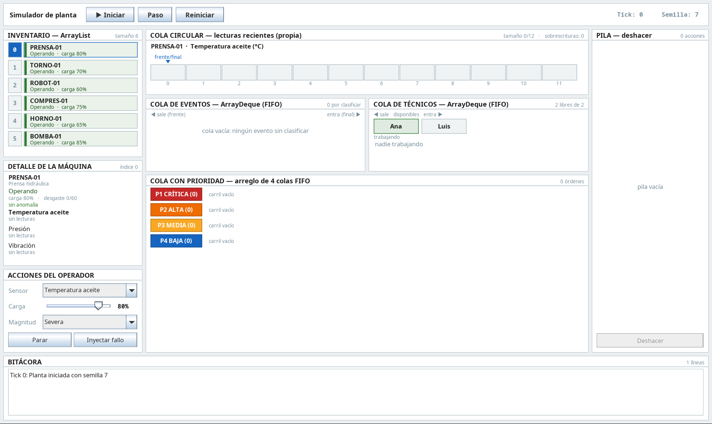
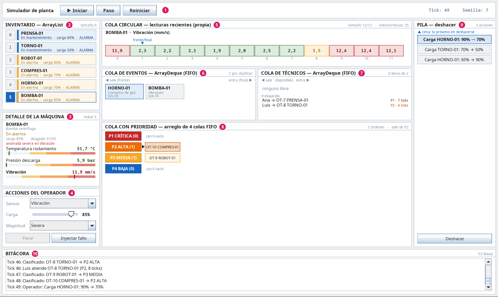
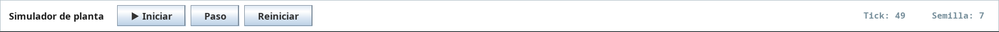
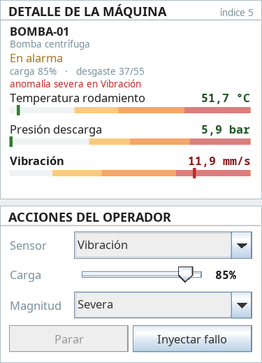
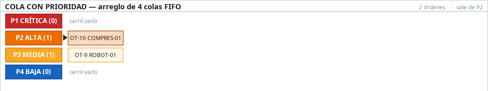
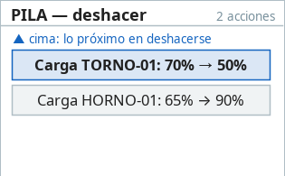
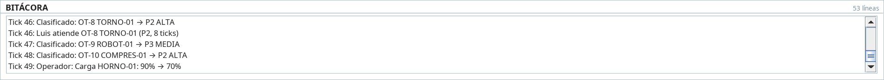
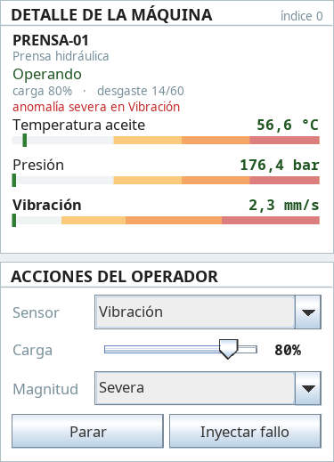
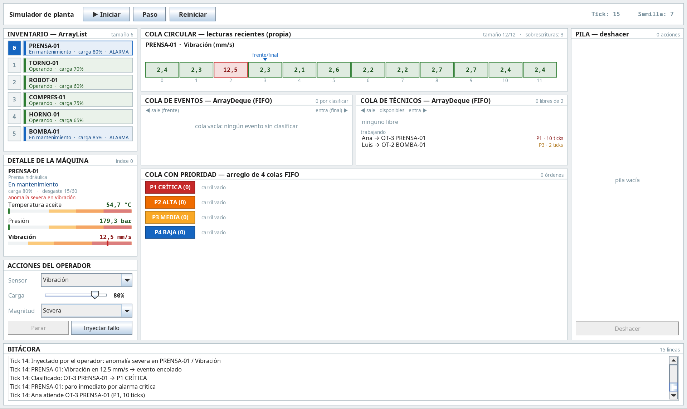

# Manual de usuario

**Simulador de Monitoreo y Mantenimiento de Planta**
Proyecto del curso Estructuras de Datos — Universidad Nacional de Colombia.
Equipo: Cristian Robayo y Kevin Toro.

Este manual explica cómo instalar, abrir y usar el simulador. No hace falta saber programar para
seguirlo. La explicación técnica de por qué se usó cada estructura de datos está en el
[documento explicativo](DOCUMENTO_EXPLICATIVO.md).

---

## Contenido

1. [Requisitos e instalación](#1-requisitos-e-instalación)
2. [La ventana principal](#2-la-ventana-principal)
3. [Controles de la simulación](#3-controles-de-la-simulación)
4. [Lectura de cada panel](#4-lectura-de-cada-panel)
5. [Acciones del operador](#5-acciones-del-operador)
6. [Guía para la demostración](#6-guía-para-la-demostración)
7. [Preguntas frecuentes](#7-preguntas-frecuentes)
8. [Glosario](#8-glosario)

---

## 1. Requisitos e instalación

### Qué necesita

- Un computador con Windows, macOS o Linux.
- **Java 21 o una versión más reciente.**

Para saber si ya tiene Java, abra una terminal (en Windows: *Símbolo del sistema* o *PowerShell*) y
escriba:

```bash
java -version
```

Si la respuesta empieza con `openjdk version "21` o un número mayor, puede seguir. Si dice que el
comando no existe o muestra una versión menor, instale Java 21 desde
[adoptium.net](https://adoptium.net/) y vuelva a intentarlo.

### Abrir el simulador

El programa es un solo archivo: `simulador-planta.jar`.

```bash
java -jar simulador-planta.jar
```

En muchos sistemas también basta con hacer doble clic sobre el archivo.

**Opcional, cambiar la semilla.** La semilla es un número que decide cómo ocurren los fallos al
azar (ver [sección 3](#la-semilla)). Si no se indica, se usa la semilla **7**. Para usar otra:

```bash
java -jar simulador-planta.jar 42
```

### Si solo tiene el código fuente

Si descargó el repositorio y no tiene el archivo `.jar`, constrúyalo así desde la carpeta del
proyecto. No necesita instalar Maven, porque el proyecto trae su propio instalador (`mvnw`):

```bash
# Linux o macOS
./mvnw package

# Windows
mvnw.cmd package
```

El archivo queda en `target/simulador-planta.jar`. Desde IntelliJ IDEA también puede abrir la carpeta
del proyecto y ejecutar la clase `edu.unal.planta.App`.

---

## 2. La ventana principal

Al abrirse, el simulador muestra una planta con **seis máquinas** funcionando con normalidad y
**dos técnicos** (Ana y Luis) esperando trabajo. El reloj está detenido: nada cambia hasta que usted
lo pone en marcha.



La ventana se divide en diez zonas. Los números de la imagen corresponden a la tabla:



| # | Zona | Para qué sirve | Estructura de datos que muestra |
|---|---|---|---|
| 1 | Barra superior | Arrancar, pausar, avanzar y reiniciar la simulación | — |
| 2 | Inventario | Ver las seis máquinas y su estado; elegir una | Arreglo dinámico |
| 3 | Detalle de la máquina | Ver los sensores de la máquina elegida | — |
| 4 | Acciones del operador | Cambiar la carga, parar o arrancar, inyectar un fallo | — |
| 5 | Cola circular | Ver las últimas 12 lecturas de la máquina elegida | Cola circular |
| 6 | Cola de eventos | Ver las alarmas que esperan ser clasificadas | Cola (FIFO) |
| 7 | Cola de técnicos | Ver quién está libre y quién trabaja | Cola (FIFO) |
| 8 | Cola con prioridad | Ver las órdenes de trabajo pendientes, de P1 a P4 | Cola con prioridad |
| 9 | Pila de deshacer | Ver y revertir sus últimas acciones | Pila |
| 10 | Bitácora | Leer, línea por línea, todo lo que ha pasado | — |

### Cómo funciona la planta, en pocas palabras

Cada cierto tiempo (un **tick**) ocurre lo siguiente:

1. Alguna máquina puede **desarrollar un fallo**. Cuanta más carga y más desgaste tenga, más
   probable es.
2. Todas las máquinas en marcha **leen sus sensores**.
3. Si una lectura se sale de lo normal, se genera una **alarma** que entra a la cola de eventos.
4. En cada tick se **clasifica una alarma** según su gravedad (P1 a P4) y se convierte en una
   **orden de trabajo**.
5. Los técnicos libres **toman la orden más urgente**. Al terminar, la máquina vuelve a funcionar.
6. Las máquinas que llevan mucho tiempo sin revisión reciben una orden de **mantenimiento
   preventivo** (P4).

---

## 3. Controles de la simulación



| Botón | Qué hace |
|---|---|
| **▶ Iniciar** | Pone en marcha el reloj: avanza un tick cada 0,8 segundos. Mientras corre, el botón cambia a **⏸ Pausar**. |
| **⏸ Pausar** | Detiene el reloj. Todo queda congelado para que pueda mirar con calma. |
| **Paso** | Avanza **un solo tick** y se detiene. Es la mejor forma de seguir lo que pasa. Si la simulación estaba corriendo, primero la pausa. |
| **Reiniciar** | Detiene el reloj y devuelve la planta al estado inicial: tick 0, sin alarmas ni órdenes, con la pila y la bitácora vacías. |

A la derecha de la barra se ven el **tick actual** y la **semilla** en uso.

### La semilla

Los fallos aparecen al azar, pero ese azar depende de la semilla. **La misma semilla produce siempre
la misma simulación**: los mismos fallos, en las mismas máquinas, en los mismos ticks. Por eso, si
pulsa **Reiniciar**, todo vuelve a ocurrir exactamente igual que la primera vez.

Esto sirve para repetir una demostración: si algo interesante pasó en el tick 30, al reiniciar
volverá a pasar en el tick 30. Para ver una simulación distinta, abra el programa con otra semilla
(ver [sección 1](#abrir-el-simulador)).

> Las acciones que usted haga (inyectar un fallo, cambiar la carga) sí modifican lo que ocurre
> después. Para repetir una demostración, repita también sus acciones en el mismo tick.

---

## 4. Lectura de cada panel

### Inventario


Una fila por máquina, con su **posición** (0 a 5) a la izquierda. La máquina seleccionada tiene la
posición resaltada en azul. **Haga clic sobre una fila para seleccionar esa máquina**: los paneles de
detalle y de cola circular pasan a mostrarla.

Cada fila indica el estado, la carga y, si la máquina tiene una alarma sin resolver, la palabra
**ALARMA**. El color de la franja izquierda indica el estado:

| Color | Estado | Qué significa |
|---|---|---|
| Verde | **Operando** | Funciona con normalidad |
| Amarillo | **En alarma** | Tiene una alarma pendiente, pero sigue funcionando |
| Rojo | **Detenida** | Se detuvo sola por una alarma crítica (P1) |
| Azul | **En mantenimiento** | Un técnico la está reparando |
| Gris | **Parada manual** | Usted la detuvo con el botón **Parar** |

### Detalle de la máquina y acciones del operador



El panel **Detalle de la máquina** muestra:

- El nombre, el tipo y el estado de la máquina seleccionada.
- **carga:** qué tan exigida está la máquina (0 a 100 %).
- **desgaste:** ticks transcurridos desde el último mantenimiento preventivo, frente al límite. Por
  ejemplo, `37/55` significa que lleva 37 de los 55 ticks permitidos. Al llegar al límite se genera
  una orden preventiva P4.
- **anomalía:** si la máquina tiene un fallo en curso, dice de qué gravedad y en qué sensor. Si no,
  dice *sin anomalía*.
- Los **tres sensores** con su última lectura y una barra. La barra va del valor normal (izquierda)
  hacia las zonas de peligro: amarillo, naranja y rojo. La marca indica dónde cayó la lectura.

El valor de cada sensor se colorea según la zona en que cae, con los mismos colores de las
prioridades:

| Color del valor | Zona | Si genera alarma, será |
|---|---|---|
| Verde | Normal | No genera alarma |
| Amarillo | Sobre el umbral de advertencia | P3 MEDIA |
| Naranja | Sobre el umbral alto | P2 ALTA |
| Rojo | Sobre el umbral crítico | P1 CRÍTICA |

El panel **Acciones del operador** se explica en la [sección 5](#5-acciones-del-operador).

### Cola circular


Muestra las **últimas 12 lecturas** del sensor elegido en la lista **Sensor**, para la máquina
seleccionada. Hay 12 casillas fijas, numeradas de 0 a 11, que se van llenando de izquierda a
derecha. Cada valor se colorea según su zona (ver la tabla anterior).

- **frente** señala la lectura más antigua que se conserva.
- **final** señala la casilla donde se escribirá la próxima lectura.

Cuando las 12 casillas están llenas, **la lectura nueva reemplaza a la más antigua**, y el puntero
vuelve a empezar desde la casilla 0. En ese momento frente y final coinciden, y se ve una sola marca
con el texto **frente/final**. Arriba a la derecha, **sobrescrituras** cuenta cuántas lecturas viejas
se han reemplazado.

En la imagen, la casilla 0 (11,9) es la más reciente y se escribió encima de una lectura anterior.
Las casillas en rojo muestran que la vibración de la bomba lleva varios ticks en zona crítica.

### Cola de eventos


Cada caja es una **alarma detectada que todavía no se ha clasificado**. Muestra la máquina, el
sensor que se salió de lo normal y el tick en que ocurrió.

- Las alarmas nuevas **entran por la derecha**.
- La alarma de la izquierda, resaltada en azul, es la **próxima en salir**.

Se clasifica **una alarma por tick**, siempre la que lleva más tiempo esperando. Por eso, si varias
máquinas fallan a la vez, aquí se ve la fila acumularse y luego vaciarse de izquierda a derecha.

### Cola de técnicos


- **disponibles:** los técnicos libres, en fila. El de la izquierda es el próximo en recibir trabajo.
  Si no hay ninguno, dice *ninguno libre*.
- **trabajando:** cada técnico ocupado, con la orden que atiende, su prioridad y los **ticks que le
  faltan** para terminar.

Cuando un técnico termina, vuelve **al final** de la fila de disponibles. Así el trabajo se reparte
por turnos entre Ana y Luis.

Una reparación tarda más cuanto más grave es: P1 = 10 ticks, P2 = 8, P3 = 6 y P4 = 4.

### Cola con prioridad



Las **órdenes de trabajo** esperando técnico, en cuatro carriles. El número entre paréntesis indica
cuántas órdenes hay en cada carril:

| Carril | Prioridad | Qué implica |
|---|---|---|
| Rojo | **P1 CRÍTICA** | Paro inmediato de la máquina |
| Naranja | **P2 ALTA** | Atender en el turno |
| Amarillo | **P3 MEDIA** | Ir a revisar |
| Azul | **P4 BAJA** | Mantenimiento preventivo programado |

Cada orden se identifica como `OT-número MÁQUINA`, por ejemplo `OT-10 COMPRES-01`.

La **flecha negra ▶** marca el carril del que sale la próxima orden, y esa orden aparece resaltada.
Las reglas son:

1. Siempre sale primero el carril más urgente que tenga órdenes.
2. Dentro de un mismo carril, sale primero la orden que llegó primero.

En la siguiente imagen, `OT-12 BOMBA-01` llegó **después** que todas las demás, pero es crítica y
por eso será la primera en atenderse:


### Pila de deshacer


Guarda sus acciones que se pueden revertir, con **la más reciente arriba** (la *cima*, resaltada en
azul). Al pulsar **Deshacer** se revierte la acción de arriba y desaparece de la pila; la siguiente
pasa a ser la cima:



El botón **Deshacer** queda desactivado cuando la pila está vacía.

### Bitácora



El registro de todo lo que ocurre, una línea por suceso, con el tick al comienzo. Siempre muestra lo
más reciente al final; use la barra de desplazamiento para leer hacia atrás. Conserva las últimas
200 líneas.

Algunas líneas típicas:

| Línea | Qué significa |
|---|---|
| `Tick 10: BOMBA-01: aparece anomalía leve en Vibración` | La máquina desarrolló un fallo por sí sola |
| `Tick 10: BOMBA-01: Vibración en 6,1 mm/s → evento encolado` | La lectura se salió de lo normal y entró a la cola de eventos |
| `Tick 48: Clasificado: OT-10 COMPRES-01 → P2 ALTA` | La alarma se convirtió en una orden de trabajo P2 |
| `Tick 14: PRENSA-01: paro inmediato por alarma crítica` | Una orden P1 detuvo la máquina |
| `Tick 46: Luis atiende OT-8 TORNO-01 (P2, 8 ticks)` | Un técnico tomó una orden |
| `Tick 9: Ana terminó OT-1 COMPRES-01; COMPRES-01 vuelve a operar` | La reparación terminó |
| `Tick 66: Preventivo: OT-10 BOMBA-01 → P4 BAJA` | La máquina cumplió su límite de desgaste |
| `Operador: Carga HORNO-01: 65% → 90%` | Una acción suya |
| `Deshecho: Carga HORNO-01: 90% → 70%` | Una acción suya que se revirtió |

---

## 5. Acciones del operador

Todas las acciones se aplican a la **máquina seleccionada** en el inventario.

### Seleccionar una máquina y un sensor

1. Haga clic sobre la máquina en el **Inventario**.
2. En **Acciones del operador**, elija un sensor en la lista **Sensor**.

El sensor elegido es el que se muestra en la cola circular y el que recibe el fallo si usa
**Inyectar fallo**. En el panel de detalle, el sensor elegido aparece en negrita.

### Cambiar la carga

1. Seleccione la máquina.
2. Arrastre el deslizador **Carga** y suéltelo en el valor deseado.

La carga se aplica al soltar el deslizador. Con más carga la máquina falla más seguido, y con menos
carga falla menos. La acción queda en la pila y se puede deshacer.

### Parar y arrancar una máquina

1. Seleccione la máquina.
2. Pulse **Parar**. La máquina pasa a *Parada manual* (gris) y deja de leer sensores y de fallar.
3. Para reanudarla, pulse **Arrancar** (es el mismo botón, que cambia de nombre).

El botón solo funciona cuando la máquina está *Operando* o en *Parada manual*. Si está en alarma,
detenida o en mantenimiento, aparece desactivado: en esos casos la máquina está en manos del sistema
de mantenimiento. Esta acción queda en la pila y se puede deshacer.

### Inyectar un fallo

Sirve para provocar a propósito una situación concreta, por ejemplo una alarma crítica durante una
demostración.



1. Seleccione la máquina. Conviene que esté **Operando** y sin alarma.
2. En **Sensor**, elija el sensor que va a fallar.
3. En **Magnitud**, elija la gravedad:

   | Magnitud | Zona en que caerá la lectura | Prioridad que recibirá |
   |---|---|---|
   | Leve | Amarilla | P3 MEDIA |
   | Moderada | Naranja | P2 ALTA |
   | Severa | Roja | P1 CRÍTICA |

4. Pulse **Inyectar fallo**. El detalle mostrará *anomalía severa en Vibración* (o la que haya
   elegido).
5. Pulse **Paso**. En ese tick la lectura se sale de lo normal y se genera la alarma.

**Inyectar un fallo no se puede deshacer.** Ver la explicación más abajo.

### Deshacer

Pulse **Deshacer**, debajo de la pila. Se revierte la acción más reciente.

**Qué se puede deshacer:**
- Cambiar la carga.
- Parar o arrancar una máquina.

**Qué no se puede deshacer:** inyectar un fallo, ni nada de lo que hace la simulación por sí sola
(clasificar alarmas, asignar técnicos). Una vez que un fallo genera una alarma, esa alarma ya está en
una fila esperando su turno o ya se convirtió en una orden. Deshacerlo obligaría a sacarla del medio
de la fila o a colarla de nuevo al frente, algo que una fila no permite: en una fila solo se entra
por el final y se sale por el frente.

**Cuando un deshacer se descarta.** Si la simulación cambió la máquina después de su acción, deshacer
ya no tiene sentido. Por ejemplo, usted arrancó una máquina, luego una alarma crítica la detuvo, y
después pulsa Deshacer: volver a "parada manual" ignoraría la alarma. En ese caso la acción se saca
de la pila **sin revertirse**, y la bitácora lo indica:

```
Descartado, la simulación ya cambió el estado: Arrancar PRENSA-01
```

---

## 6. Guía para la demostración

Esta secuencia muestra todas las estructuras en acción en pocos minutos. Use la semilla por omisión
(7) para que los resultados coincidan con los descritos.

### A. Una alarma crítica, de principio a fin

1. Abra el simulador y pulse **Paso** 14 veces, hasta que la barra diga **Tick: 14**.
   En el camino verá en la bitácora dos alarmas P3 (tick 3 en COMPRES-01 y tick 10 en BOMBA-01) y
   cómo Ana y Luis las atienden.
2. Observe la **cola circular** de cualquier máquina: después del tick 12 las casillas ya están
   llenas, aparece **frente/final** y el contador de sobrescrituras empieza a subir.
3. Seleccione **PRENSA-01** en el inventario. En **Sensor** elija *Vibración* y en **Magnitud**
   elija *Severa*. Pulse **Inyectar fallo**.
4. Pulse **Paso**. En un solo tick ocurre todo el recorrido, y la bitácora lo cuenta:

   ```
   Tick 14: PRENSA-01: Vibración en 12,5 mm/s → evento encolado
   Tick 14: Clasificado: OT-3 PRENSA-01 → P1 CRÍTICA
   Tick 14: PRENSA-01: paro inmediato por alarma crítica
   Tick 14: Ana atiende OT-3 PRENSA-01 (P1, 10 ticks)
   ```

   

   Todo ocurre en el mismo tick porque la cola de eventos estaba vacía y Ana estaba libre. En la
   cola circular, la casilla con 12,5 aparece en rojo.
5. Pulse **Paso** varias veces y siga a Ana en la cola de técnicos: sus ticks restantes bajan de
   10 a 0. Al terminar, PRENSA-01 vuelve a *Operando* y Ana regresa al final de la fila de
   disponibles.

### B. Ver las colas llenarse

Para que se formen filas, provoque varios fallos a la vez:

1. Pulse **Reiniciar** y avance hasta un tick en que los dos técnicos estén libres.
2. Inyecte un fallo en cada máquina que esté *Operando*, alternando magnitudes. Por ejemplo: PRENSA
   severa, TORNO moderada, ROBOT leve, COMPRES moderada, HORNO leve y BOMBA severa.
3. Pulse **Paso** una vez a la vez y observe:
   - La **cola de eventos** se llena de golpe y se vacía de a una alarma por tick, siempre por la
     izquierda.
   - Los técnicos se ocupan y la palabra *ninguno libre* aparece en su cola.
   - La **cola con prioridad** empieza a llenar sus carriles.
   - Cuando sale de la cola de eventos la alarma severa de BOMBA-01, que fue la última en entrar,
     su orden P1 se coloca **delante de todas** las demás.

### C. La pila de deshacer

1. Seleccione una máquina *Operando*. Mueva la **Carga** dos veces, a valores distintos, y pulse
   **Parar**.
2. La pila muestra tres acciones, con *Parar …* en la cima.
3. Pulse **Deshacer** tres veces: la máquina vuelve a arrancar y luego recupera las cargas, en orden
   inverso al que usted las hizo.

---

## 7. Preguntas frecuentes

**¿Por qué una máquina con alarma no genera una segunda alarma?**
Mientras una máquina tiene una alarma sin resolver, no se generan más alarmas suyas aunque sus
lecturas sigan siendo malas. En las salas de control reales, una sola falla que dispara decenas de
alarmas iguales esconde los problemas nuevos (se le llama *inundación de alarmas*). La alarma se
resuelve cuando un técnico termina la reparación.

**¿Por qué se clasifica una sola alarma por tick?**
Para que la cola de eventos se pueda ver funcionando. Si se clasificaran todas a la vez, la cola
estaría siempre vacía y no se notaría el orden de llegada.

**Inyecté un fallo y no pasó nada. ¿Por qué?**
La alarma aparece en el siguiente tick: pulse **Paso**. Si aun así no aparece, revise el estado de
la máquina. Si ya tenía una alarma activa, no genera otra (ver la primera pregunta). Si estaba en
mantenimiento o detenida, no lee sensores, y el técnico borra el fallo al terminar la reparación.

**¿Por qué el botón Parar está desactivado?**
Solo se puede parar o arrancar una máquina que esté *Operando* o en *Parada manual*. Pase el cursor
sobre el botón para ver en qué estado está la máquina.

**Pulsé Deshacer y la bitácora dice "Descartado". ¿Qué pasó?**
La simulación cambió el estado de la máquina después de su acción. Revertirla dejaría la máquina en
un estado inconsistente, así que la acción se retira de la pila sin aplicarse. Ver
[Deshacer](#deshacer).

**¿Por qué la carga o el desgaste afectan los fallos?**
La probabilidad de que una máquina falle aumenta con su carga y con el tiempo que lleva sin
mantenimiento preventivo. Solo una orden P4 (preventiva) reinicia el desgaste. Una reparación por
alarma corrige el fallo, pero no reemplaza la revisión programada.

**¿Por qué la cola de eventos casi siempre está vacía?**
Una alarma se detecta y se clasifica en el mismo tick, así que solo se ve esperando cuando varias
máquinas fallan a la vez. Sin intervención, eso ocurre en muy pocos ticks. Con la cola con
prioridad pasa algo parecido: las órdenes solo esperan cuando los dos técnicos están ocupados. Para
ver las dos colas llenas, siga la [guía B](#b-ver-las-colas-llenarse).

---

## 8. Glosario

| Término | Significado |
|---|---|
| **Tick** | Una unidad de tiempo de la simulación. Con **Iniciar** pasa un tick cada 0,8 segundos; con **Paso**, uno por clic. |
| **Semilla** | Número que determina el azar de la simulación. La misma semilla repite la misma simulación. |
| **Anomalía** | Fallo físico en una máquina, que desvía la lectura de uno de sus sensores. |
| **Evento / alarma** | Aviso de que una lectura superó un umbral. Todavía no tiene prioridad. |
| **Orden de trabajo (OT)** | Alarma ya clasificada, con prioridad, lista para que un técnico la atienda. |
| **Umbral** | Valor límite de un sensor: de advertencia, alto o crítico. |
| **Mantenimiento preventivo** | Revisión programada que se hace por tiempo de uso, no por un fallo. Genera órdenes P4. |
| **Desgaste** | Ticks desde el último mantenimiento preventivo. |
